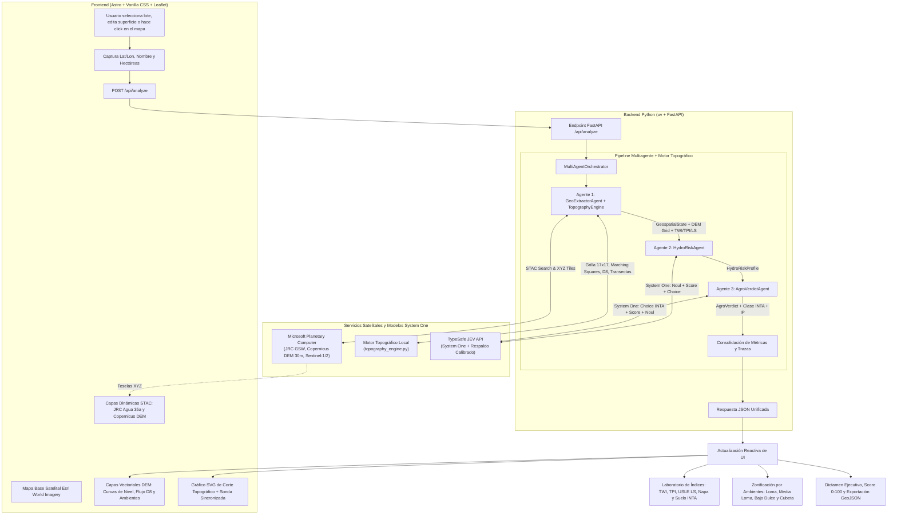

# AgroJEV · Estudio Topográfico, Suite Geodésica y Auditoría de Terrenos (Argentina y Global)

Plataforma Full-Stack de alta precisión para **estudiar la topografía y geodesia de terrenos rurales**, auditar parcelas agropecuarias y determinar su **aptitud agronómica**, **Capacidad de Uso de la Tierra (Clases I a VIII USDA/INTA)**, **zonificación por ambientes**, **parámetros geodésicos oficiales (POSGAR 2007 / UTM / Geoide)** y **vulnerabilidad a inundaciones o erosión hídrica** en la **República Argentina y a nivel global**.

El sistema combina datos satelitales abiertos de **Microsoft Planetary Computer STAC** (Copernicus DEM 30m, JRC Global Surface Water, Sentinel-1/2, ESA WorldCover), un **Motor Topográfico DEM** (curvas de nivel *Marching Squares*, vectores de escurrimiento D8, cortes topográficos con nivel freático e índices $\text{TWI}$, $\text{TPI}$ y $\text{USLE } LS$), un **Motor Geodésico Analítico Oficial** (POSGAR 2007 Fajas 1–7, EPSG:5343–5349, UTM, Geoide EGM2008 / GEOIDE-Ar 16, terna $h = H + N$, declinación WMM y derrotero de mensura), el razonamiento tipado y calibrado de **TypeSafe JEV (System One)**, un backend asíncrono en **Python (`uv` + FastAPI)** y una interfaz web interactiva en **Astro + Leaflet**.

---

## Índice

1. [Problema que Resuelve y Generalización Territorial](#1-problema-que-resuelve-y-generalización-territorial)
   - [1.1. Contexto Hidro-Edáfico Pampeano](#11-contexto-hidro-edáfico-pampeano)
   - [1.2. Alcance Territorial y Generalización (Argentina Fajas 1-7 y Global)](#12-alcance-territorial-y-generalización-argentina-fajas-1-7-y-global)
   - [1.3. ¿Por qué JEV System One + Rotador de Claves y no un LLM tradicional?](#13-por-qué-jev-typesafe-system-one--rotador-de-api-keys-y-no-un-llm-tradicional)
2. [Arquitectura General del Sistema](#2-arquitectura-general-del-sistema)
3. [Laboratorio Topográfico, Geomorfológico, Geodésico y de Ambientes](#3-laboratorio-topográfico-geomorfológico-y-de-ambientes)
   - [3.1. Mapa Topográfico Interactivo y Selector Multicapa Base](#31-mapa-topográfico-interactivo-y-selector-multicapa-base)
   - [3.2. Perfiles de Elevación / Cortes Topográficos con Nivel Freático](#32-perfiles-de-elevación--cortes-topográficos-con-nivel-freático)
   - [3.3. Índices Geomorfológicos, Hidrológicos y de Erosión](#33-índices-geomorfológicos-hidrológicos-y-de-erosión)
   - [3.4. Módulo Geodésico Oficial (POSGAR 2007, Gauss-Krüger, Geoide, UTM y Mensura)](#34-módulo-geodésico-oficial-posgar-2007-gauss-krüger-geoide-y-utm)
   - [3.5. Zonificación por Ambientes Productivos (Agricultura de Precisión y Relieve Serrano)](#35-zonificación-por-ambientes-productivos-agricultura-de-precisión-y-relieve-serrano)
   - [3.6. Exportación Cartográfica Profesional (DXF 3D AutoCAD, KML y GeoJSON)](#36-exportación-cartográfica-profesional-dxf-autocad-kml-y-geojson)
4. [Fuentes de Datos Satelitales (Microsoft Planetary Computer)](#4-fuentes-de-datos-satelitales-microsoft-planetary-computer)
5. [Funcionamiento Detallado del Pipeline Multiagente con JEV](#5-funcionamiento-detallado-del-pipeline-multiagente-con-jev)
   - [Agente 1: Extractor Geoespacial y Motor Topográfico (`GeoExtractorAgent`)](#agente-1-extractor-geoespacial-y-motor-topográfico-geoextractoragent)
   - [Agente 2: Evaluador de Riesgo Hidrológico (`HydroRiskAgent`)](#agente-2-evaluador-de-riesgo-hidrológico-hydroriskagent)
   - [Agente 3: Clasificación INTA y Dictamen Agronómico (`AgroVerdictAgent`)](#agente-3-clasificación-inta-y-dictamen-agronómico-agroverdictagent)
   - [Orquestador Asíncrono (`MultiAgentOrchestrator`)](#orquestador-asíncrono-multiagentorchestrator)
6. [Frontend y Experiencia de Usuario (Astro + Leaflet)](#6-frontend-y-experiencia-de-usuario-astro--leaflet)
7. [Estructura del Proyecto](#7-estructura-del-proyecto)
8. [Guía de Instalación y Ejecución](#8-guía-de-instalación-y-ejecución)
9. [Casos de Estudio Reales y Validación Territorial](#9-casos-de-estudio-reales-en-buenos-aires)
10. [Especificación de la API REST](#10-especificación-de-la-api-rest)
11. [Auditoría Técnica Integral (Frontend, Backend y Caso Sierras de la Ventana)](#11-auditoría-técnica-integral-frontend-backend-y-caso-sierras-de-la-ventana)
12. [Licencia y Créditos](#12-licencia-y-créditos)

---

## 1. Problema que Resuelve y Generalización Territorial

### 1.1. Contexto Hidro-Edáfico Pampeano

La región pampeana argentina (y en particular la Provincia de Buenos Aires) sirvió como banco de calibración de alta exigencia: es una de las áreas agrícolas más productivas del planeta, pero presenta marcadas complejidades donde **diferencias de apenas 30 a 50 centímetros de relieve determinan el éxito de una cosecha o la pérdida total por anegamiento**:
* **Pendientes mínimas o nulas (Pampa Deprimida):** En la Cuenca del Río Salado las pendientes suelen ser inferiores al $0.1\%$ ($< 1\text{ m/km}$), impidiendo la evacuación rápida de excedentes hídricos y favoreciendo suelos alcalino-sódicos (*Natraquoles* con horizonte $Bt$ nátrico).
* **Cuencas arreicas y endorreicas (Pampa Arenosa e Interserrana):** Abundancia de cordones medanosos longitudinales, bajos intermedanosos y cubetas de deflación donde el agua drena por infiltración o se acumula formando lagunas temporarias y ascenso de la napa freática.
* **Erosión hídrica en pendientes (Pampa Ondulada y Piedemontes Serranos):** En el norte bonaerense y sur santafesino (Pergamino, Arrecifes, Venado Tuerto) y en los piedemontes de Tandilia y Ventania, las pendientes de $0.8\%$ a $5\%$ generan escorrentía concentrada y pérdida de suelo superficial por erosión laminar y en surcos.
* **Restricción topográfica y lítica en cordones serranos escarpados (Sierras de la Ventana / Crestas de Tandilia):** En el arco plegado del Sistema de Ventania (Cerro Tres Picos, Sierra de la Ventana, Villa Ventana, Curamalal, Pillahuincó; cotas de $360\text{–}800+\text{ msnm}$ y pendientes del $11\%\text{–}26\%$), el basamento cuarcítico paleozoico aflora en superficie o presenta contacto lítico somero ($< 25\text{ cm}$), haciendo que el terreno sea **estrictamente no cultivable (Clases VII–VIII INTA, Subclase `e/s`)** pese a no sufrir anegamiento.
* **Variabilidad climática extrema:** La alternancia entre fases húmedas (*El Niño*) y secas (*La Niña*) exige conocer el micro-relieve y la posición de la napa freática antes de comprar, arrendar o sembrar un lote.

### 1.2. Alcance Territorial y Generalización (Argentina Fajas 1-7 y Cobertura Global)

Aunque el proyecto inició enfocado en la heterogeneidad bonaerense, **el sistema está 100% generalizado para operar en cualquier punto de la República Argentina y a escala global**:

1. **Marco Geodésico Nacional Oficial (POSGAR 2007 / RAMSAC / IGN):**
   * El motor geodésico analítico (`geodesy_engine.py`) detecta automáticamente la longitud geográfica y proyecta a la **Faja Gauss-Krüger correspondiente (1 a 7)** con meridiano central oficial cada 3°:
     * **Faja 1** (MC $-72^\circ$, EPSG:5343): Cordillera Austral / Santa Cruz / Chubut cordillerano.
     * **Faja 2** (MC $-69^\circ$, EPSG:5344): Cuyo, Mendoza, San Juan, Neuquén, Río Negro andino.
     * **Faja 3** (MC $-66^\circ$, EPSG:5345): NOA (Salta, Jujuy, Tucumán, Catamarca, La Rioja), San Luis, La Pampa occidental.
     * **Faja 4** (MC $-63^\circ$, EPSG:5346): Córdoba, Santiago del Estero, centro de Río Negro y Chubut.
     * **Faja 5** (MC $-60^\circ$, EPSG:5347): Santa Fe, Chaco, Formosa, Buenos Aires occidental.
     * **Faja 6** (MC $-57^\circ$, EPSG:5348): Buenos Aires centro-este, Entre Ríos, Corrientes.
     * **Faja 7** (MC $-54^\circ$, EPSG:5349): Misiones y extremo oriental mesopotámico.
   * Modela la ondulación geoidal $N$ precisa mediante **GEOIDE-Ar 16 / EGM2008**, permitiendo relacionar la altura ortométrica $H$ sobre el nivel del mar con la elipsoidal $h$ ($h = H + N$) requerida por cuadrillas de agrimensura y equipos GPS/GNSS RTK.
2. **Proyección UTM y Estándar Global:**
   * Convierte automáticamente a zonas UTM (Zonas 19S a 21S en el cono sur, y zonas 1 a 60 en cualquier latitud del mundo), compatible con software de fotogrametría, drones (DJI Terra, Pix4D) y plataformas CAD/BIM.
3. **Sensores Satelitales Abiertos de Cobertura Planetaria:**
   * **Copernicus DEM 30m (ESA GLO-30):** Cobertura mundial continua sin huecos de datos.
   * **JRC Global Surface Water (Comisión Europea / Landsat):** 38+ años de recurrencia de agua sobre cualquier cuerpo continental.
   * **Sentinel-1 SAR y Sentinel-2 Óptico:** Cobertura global sistemática de la Agencia Espacial Europea.
4. **Metodología de Clasificación Agronómica Universal (USDA / FAO Land Capability Classification):**
   * El sistema de **Capacidad de Uso de la Tierra (Clases I a VIII)** y subclases limitantes (`w` hídrica, `e` erosión, `s` suelo/lítico/salino, `c` clima) adoptado por el INTA en Argentina es exactamente la norma internacional de la USDA y la FAO, aplicable en cualquier región agrícola del mundo (América Latina, Norteamérica, Europa, etc.).

### 1.3. ¿Por qué JEV (TypeSafe System One) + Rotador de API Keys y no un LLM tradicional?
Los modelos de lenguaje generativos tradicionales generan texto libre no estructurado y sufren de alucinaciones numéricas. **JEV** es un modelo de **System One** entrenado para emitir **juicios rápidos, tipados y matemáticamente calibrados**:
* Devuelve probabilidades reales ($P \in [0, 1]$) y distribuciones completas sobre opciones competitivas.
* Integra primitivas estrictas (`Noul`, `Score`, `Choice`) que el código backend consume de forma determinista y segura.
* **Rotador Multi-Clave Anti-503/409 (`key_rotator.py`):** Lee múltiples claves desde `.env` (separadas por comas, punto y coma o saltos de línea, con recarga en caliente por `mtime`), balancea peticiones mediante *Round-Robin* priorizando claves sin vuelos concurrentes (`in_flight == 0` para evitar `409 Conflict`), y aplica *exponential backoff* con *jitter* ante respuestas `503 Service Unavailable`, `409 Conflict` o `429 Rate Limit`.
* Cuenta además con un motor de respaldo hidro-edáfico y topográfico calibrado en `jev_service.py` para garantizar disponibilidad continua ($< 2.5\text{ s}$) ante saturación externa.

---

## 2. Arquitectura General del Sistema

El siguiente diagrama ilustra el flujo integral desde la selección o el trazado de un corte en el mapa hasta el modelado topográfico DEM, la consulta STAC y la inferencia multiagente en JEV:



---

## 3. Laboratorio Topográfico, Geomorfológico y de Ambientes

El módulo `backend/src/services/topography_engine.py` en combinación con `backend/src/services/geodesy_engine.py` transforma las coordenadas y la superficie de la parcela en un estudio topográfico y geodésico completo de ingeniería rural y agrimensura:

### 3.1. Mapa Topográfico Interactivo y Selector Multicapa Base
* **Selector Multicapa de Mapas Base:** Permite alternar en tiempo real entre 4 proveedores cartográficos según la etapa del estudio:
  * 🛰️ **Satelital (Esri World Imagery):** Ortofotografía de muy alta resolución para reconocimiento visual de alambrados, tranqueras, cascos, caminos vecinales, tajamares y estado del canopeo del cultivo.
  * 🗺️ **Topográfico (OpenTopoMap):** Cartografía topográfica global de curvas de nivel, hipsometría sombreada y elementos fisiográficos basada en datos OSM y modelos SRTM.
  * ⛰️ **Relieve Sombreado (ESRI Shaded Relief):** Mapa de relieve físico puro con sombreado de laderas (*hillshade*) ideal para identificar escarpes, talwegs, divisorias de aguas y morfologías de cuenca sin distracciones.
  * 🚗 **OpenStreetMap (OSM Estándar):** Cartografía vectorial clásica con nombres de parajes, hidrografía oficial, red vial rural y vías férreas.
* **Malla Digital de Elevación Local ($17 \times 17$):** Genera una matriz de $289$ puntos altimétricos calibrada con la geomorfología de cada región (lomadas pampeanas, cubetas de deflación, médanos longitudinales, valles fluviales o macizos serranos).
* **Curvas de Nivel / Isolíneas (*Marching Squares*):**
  * Interpolación lineal sub-celda que genera polilíneas continuas de igual altitud ($\text{msnm}$).
  * **Equidistancia automática adaptativa según el relieve:** `0.25 m` en llanuras deprimidas, `0.5 m` en zonas medanosas/intermedias, `1.0 m` en llanuras onduladas y `5.0 m` a `10.0 m` en zonas serranas o montañosas.
  * Diferenciación visual entre **curvas maestras** (trazo continuo con etiqueta de cota en metros) y **curvas intermedias** (trazo discontinuo).
* **Vectores de Escurrimiento Superficial (Algoritmo D8):**
  * Calcula el gradiente bidimensional $(\partial z / \partial x, \partial z / \partial y)$ y propaga la acumulación de flujo desde las cotas superiores hacia las inferiores.
  * Dibuja flechas orientadas según el azimut de caída e identifica en color cian brillante las **vías de escurrimiento concentrado (*talwegs* / cañadas)**.
* **Cuadrícula Geodésica Activa (*Graticule*):** Capa interactiva de meridianos y paralelos superpuesta sobre el mapa con espaciado dinámico según el nivel de zoom.
* **Barra Inferior de Telemetría Geodésica (HUD):** Lectura continua bajo el cursor del ratón con Latitud/Longitud sexagesimal (DMS), Faja Gauss-Krüger POSGAR 2007, Zona UTM y Ondulación del Geoide $N$ local.

### 3.2. Perfiles de Elevación / Cortes Topográficos con Nivel Freático
* **3 Transectas Automáticas:**
  1. **Corte Norte → Sur (N–S)**
  2. **Corte Oeste → Este (O–E)**
  3. **Eje de Escurrimiento Dominante (Diagonal NO → SE)**
* **Modo Interactivo `📏 Trazar Corte Topográfico (A → B)` en el Mapa:**
  * Permite hacer click en cualquier **Punto A** y **Punto B** dentro del mapa para interpolar bilinealmente $25$ estaciones sobre la malla DEM y graficar al instante el corte longitudinal personalizado.
* **Doble Curva (Superficie + Napa Freática):**
  * Muestra simultáneamente la **cota superficial del terreno** (coloreada tramo a tramo según el ambiente edáfico) y la **cota estimada de la napa freática ($\text{msnm}$)**, permitiendo visualizar en qué depresiones la freática se acerca a la superficie o aflora.
* **Sonda Sincronizada Mapa ↔ Gráfico:** Al desplazar el cursor sobre el perfil SVG, un marcador sonda se mueve en vivo sobre el mapa satelital indicando distancia acumulada ($\text{m}$), cota ($\text{msnm}$), profundidad de napa ($\text{m}$) y pendiente local ($\%$).

### 3.3. Índices Geomorfológicos, Hidrológicos y de Erosión
Para cada lote auditado se calculan 6 indicadores técnicos fundamentales:
1. **Índice de Humedad Topográfica ($\text{TWI}$ - *Topographic Wetness Index*):**
   $$\text{TWI} = \ln\left(\frac{A_s}{\tan\beta}\right)$$
   Donde $A_s$ es el área de captación específica por unidad de contorno y $\beta$ el ángulo de pendiente. Valores $> 12.5$ alertan propensión severa a saturación hídrica; valores entre $8$ y $10$ indican óptima retención de humedad útil.
2. **Índice de Posición Topográfica ($\text{TPI}$ - *Topographic Position Index*):**
   $$\text{TPI} = z_0 - \bar{z}_{\text{entorno}}$$
   Mide en metros si el centro del lote se encuentra elevado respecto a sus vecinos ($\text{TPI} > 0$, *loma convexa emisora*) o deprimido ($\text{TPI} < 0$, *bajo o cubeta cóncava receptora*), acompañado de la **Amplitud de Relieve ($\Delta H = z_{\max} - z_{\min}$)**.
3. **Pendiente Media/Máxima ($\%$ y $^\circ$) y Orientación de Ladera (*Aspect*):**
   Calcula la pendiente en grados y en porcentaje ($\text{m de caída cada } 100\text{ m}$), el azimut dominante ($0^\circ\text{–}360^\circ$) y su efecto de insolación (*Solana cálida N/NO* vs. *Umbría fresca S/SO* o *Plano horizontal*).
4. **Factor Topográfico de Erosión Hídrica ($\text{USLE / RUSLE } LS$) y Rugosidad ($\text{TRI}$):**
   Estima el riesgo de pérdida laminar y en surcos por escorrentía superficial junto con el *Terrain Ruggedness Index* ($\text{m}$).
5. **Profundidad Estimada de Napa Freática ($\text{m}$) y Tipo de Red de Drenaje:**
   Clasifica la cuenca como **Exorreica definida**, **Endorreica / Arreica de cubetas** o **Arreica medanosa**.
6. **Taxonomía Edáfica Estimada (INTA):**
   Identifica el Gran Grupo taxonómico representativo de la subregión (*Argiudol típico*, *Natraquol típico / Natracualf*, *Hapludol éntico / thapto-árgico*, *Hapludol lítico / petrocálcico*).

### 3.4. Módulo Geodésico Oficial (POSGAR 2007, Gauss-Krüger, Geoide, UTM y Mensura)
El sistema integra un motor geodésico analítico (`backend/src/services/geodesy_engine.py`) adaptado a las especificaciones del **Instituto Geográfico Nacional de la República Argentina (IGN / RAMSAC)** y al estándar internacional **IOGP / EPSG**:
* **Proyección Gauss-Krüger Oficial / POSGAR 2007 (Fajas 1 a 7):**
  * Asignación y transformación rigurosa a la **Faja Gauss-Krüger (1 a 7)** con meridiano central oficial cada 3°:
    * Faja 1 (MC $-72^\circ$): EPSG:5343 (Andes Patagónicos / Santa Cruz / Chubut Oeste)
    * Faja 2 (MC $-69^\circ$): EPSG:5344 (Cuyo / Mendoza / San Juan / Neuquén / Río Negro Oeste)
    * Faja 3 (MC $-66^\circ$): EPSG:5345 (NOA / Salta / Jujuy / Catamarca / La Rioja / San Luis / La Pampa Oeste)
    * Faja 4 (MC $-63^\circ$): EPSG:5346 (Córdoba / Santiago del Estero / Río Negro Centro)
    * Faja 5 (MC $-60^\circ$): EPSG:5347 (Buenos Aires Oeste / Santa Fe / Chaco / Formosa)
    * Faja 6 (MC $-57^\circ$): EPSG:5348 (Buenos Aires Centro-Este / Entre Ríos / Corrientes)
    * Faja 7 (MC $-54^\circ$): EPSG:5349 (Misiones)
  * Coordenadas Planas oficiales: **Norte ($X$)** (distancia geodésica al Polo Sur) y **Este ($Y$)** con prefijo de faja ($Y = \text{Faja} \times 1.000.000 + 500.000 + y_{\text{rel}}$) bajo el elipsoide GRS80/WGS84.
* **Conversión a Coordenadas UTM Globales:**
  * Proyección Cilíndrica Conforme Transversal Universal para cualquier punto del planeta (Zonas 1 a 60, Hemisferios Norte y Sur), con Este ($X$) y Norte ($Y$) estandarizados.
* **Formato Sexagesimal (DMS):**
  * Conversión de alta precisión a Grados, Minutos y Segundos con indicación cardinal exacta ($33^\circ 57' 00.00''\text{ S}, 60^\circ 37' 12.00''\text{ W}$).
* **Terna Altimétrica Geodésica ($H, N, h$):**
  * **Cota Ortométrica ($H$):** Altura sobre el nivel medio del mar / geoide físico ($\text{msnm}$).
  * **Ondulación Geoidal ($N$):** Separación elipsoide-geoide modelada según **GEOIDE-Ar 16 / EGM2008 (IGN)** ($+12.0\text{ m}$ a $+24.0\text{ m}$ en Argentina).
  * **Altura Elipsoidal ($h$):** Relación geodésica fundamental:
    $$h = H + N$$
    Indispensable para contrastar y calibrar cotas con receptores GNSS/GPS de doble frecuencia (L1/L2 RTK) en tareas de amojonamiento y nivelación agronómica.
* **Orientación y Campo Geomagnético:**
  * **Declinación Magnética:** Desviación angular respecto al Norte Magnético según el Modelo Magnético Mundial (WMM).
  * **Convergencia de Meridianos ($\gamma$):** Ángulo entre el Norte de Cuadrícula de la proyección y el Norte Geográfico Verdadero.
* **Herramienta Interactiva de Agrimensura (`📐 Medición Geodésica`):**
  * Activación mediante el botón de compás en la barra de herramientas del mapa.
  * Permite pinchar vértices de linderos o alambrados sobre el mapa con polilíneas elipsoidales.
  * **Cálculo de Distancias:** Distancia geodésica por tramo ($\text{m}$ y $\text{km}$) y perímetro acumulado.
  * **Cálculo de Superficie Poligonal:** Área geodésica proyectada en hectáreas ($\text{ha}$) y metros cuadrados ($\text{m}^2$).
  * **Azimut y Rumbos Cuadrantales (Bearings):** Orientación náutica y catastral de cada lado (ej. `N 42° 15' 20'' E`, azimut `042.3°`).
  * **Tarjeta Flotante de Derrotero (HUD):** Tabla interactiva con Vértice, Coordenadas Geográficas (DMS), Distancia parcial y Rumbo, lista para volcar a actas de mensura y peritajes de deslinde.

### 3.5. Zonificación por Ambientes Productivos (Agricultura de Precisión y Relieve Serrano)
Segmenta automáticamente la superficie total del lote (`area_ha`) en **4 ambientes geomorfológicos**, adaptando la semántica según se trate de **llanura/piedemonte** o de un **macizo serrano escarpado (`serrano_escarpado`)**:

**En Llanura Pampeana y Piedemontes Agrícolas:**
* 🟢 **Loma Alta Bien Drenada:** Suelo profundo y aireado, apto para cultivos exigentes (Maíz temprano, Soja 1ª, Trigo) con alta respuesta a fertilización.
* 🔵 **Media Loma de Transición:** Posición intermedia con excelente provisión de agua útil en años secos y buen drenaje en años normales.
* 🟡 **Bajo Tendido / Bajo Dulce:** Zona receptora de escorrentía con napa cercana; apta para cultivos tolerantes (Sorgo, Maíz tardío) o pasturas consociadas.
* 🔴 **Bajo Inundable / Cubeta Alcalina:** Depresión de acumulación hídrica o alcalinidad sódica (*horizonte Bt nátrico*); uso exclusivo ganadero (*Agropiro*, *Lotus tenuis*) o reserva hídrica.

**En Cordones Serranos Escarpados (Sierras de la Ventana / Crestas de Tandilia):**
En macizos plegados con pendientes $> 8.5\%$ o cotas $> 310\text{ msnm}$, la relación altitud-aptitud se invierte (las cumbres son roca desnuda y sólo el pie coluvial acumula sedimento):
* 🔴 **Cumbre y Afloramiento Rocoso Cuarcítico (Cotas superiores):** Roca paleozoica aflorante sin desarrollo edáfico útil ($< 10\text{–}15\text{ cm}$). No cultivable (**Clase VIII INTA**).
* 🟡 **Ladera Serrana Escarpada (Media-alta ladera):** Fuerte pendiente ($> 10\%$), escorrentía torrencial y suelo lítico somero ($< 25\text{ cm}$). Inapto para laboreo agrícola (**Clases VI–VII INTA**).
* 🔵 **Faldeo Periserrano Tendido:** Ladera inferior con contacto lítico/petrocálcico somero ($30\text{–}50\text{ cm}$); uso ganadero extensivo controlado.
* 🟢 **Piedemonte Coluvial (Valle Serrano):** Sector basal de acumulación coluvial apto únicamente para pasturas o verdeos en contorno.

### 3.6. Exportación Cartográfica Profesional (DXF 3D AutoCAD, KML y GeoJSON)
El visor ofrece descarga directa en formatos estándar de ingeniería, agrimensura y SIG:
* **`📐 Exportar DXF (AutoCAD / Civil 3D)`:**
  * Genera un archivo DXF R12 estructurado en capas CAD separadas:
    * Capa `CURVAS_NIVEL`: Polilíneas 3D (`POLYLINE` con código de cota $Z$ en metros reales para cada vértice), listas para generar superficies TIN o mallas de triangulación topográfica directa en AutoCAD Civil 3D, QGIS o Carlson Survey.
    * Capa `DERROTERO_VERTICES`: Contiene las líneas perimetrales, puntos de estación y derrotero mensurados en el mapa.
* **`🌐 Exportar KML`:**
  * Archivo KML georreferenciado para **Google Earth Pro** o Google Earth Web.
  * Incluye carpetas jerárquicas con las curvas de nivel georreferenciadas, el placemark de dictamen agronómico y los metadatos completos del lote.
* **`⬇️ Exportar GeoJSON`:**
  * Formato geoespacial estándar para QGIS, ArcGIS y GeoPandas conteniendo isolíneas, vectores D8, el centroide del lote y el polígono de estudio.

---

## 4. Fuentes de Datos Satelitales (Microsoft Planetary Computer)

El backend consulta en tiempo real el catálogo STAC (`https://planetarycomputer.microsoft.com/api/stac/v1`) y el servidor de teselas dinámicas (`https://planetarycomputer.microsoft.com/api/data/v1`):

1. **`jrc-gsw` (JRC Global Surface Water):** Serie histórica de más de 35 años de observaciones Landsat (1984–presente). Provee el porcentaje de recurrencia de agua superficial (`occurrence` $0\%\text{–}100\%$), máxima extensión histórica (`max_extent`) y estacionalidad (`permanente`, `estacional`, `efímero`, `seco`).
2. **`cop-dem-glo-30` (Copernicus DEM 30m):** Modelo Digital de Elevación global de la Agencia Espacial Europea (ESA) a 30 metros de resolución.
3. **`sentinel-1-rtc` (Radar SAR Sentinel-1):** Retrodispersión radar en Banda C ($\text{dB}$) capaz de atravesar nubes y detectar espejos de agua libre bajo vegetación ($< -16\text{ dB}$).
4. **`sentinel-2-l2a` (Óptico Multiespectral Sentinel-2):** Índice Diferencial de Agua Normalizado ($\text{NDWI}$) para monitoreo de humedad superficial.

---

## 5. Funcionamiento Detallado del Pipeline Multiagente con JEV

El sistema divide el procesamiento en tres agentes especializados y secuenciales coordinados por `MultiAgentOrchestrator`:

```text
[Coordenadas + Ha] ──> [Agente 1: STAC + Motor DEM] ──> [Agente 2: Riesgo Hídrico JEV] ──> [Agente 3: Clasificación INTA y Dictamen JEV]
```

### Agente 1: Extractor Geoespacial y Motor Topográfico (`GeoExtractorAgent`)
* **Archivos:** `backend/src/agents/geo_extractor.py`, `backend/src/services/planetary_stac.py`, `backend/src/services/topography_engine.py`
* **Misión:** Adquirir los metadatos STAC, generar las URLs de teselas dinámicas y ejecutar `build_topographic_analysis` para construir la grilla DEM, curvas de nivel, vectores D8, cortes de elevación, índices geomorfológicos y distribución de ambientes.
* **Salida Tipada:** `GeospatialState` (incluyendo el objeto anidado `TopographicAnalysisData`).

### Agente 2: Evaluador de Riesgo Hidrológico (`HydroRiskAgent`)
* **Archivo:** `backend/src/agents/hydro_risk.py`
* **Misión:** Evaluar la vulnerabilidad hídrica cruzando la recurrencia satelital JRC con los nuevos indicadores topográficos ($\text{TWI}$, $\text{TPI}$, profundidad de napa y distribución de bajos) mediante **JEV System One**:
  1. **`Noul` (`riesgo_severo`)**: Probabilidad calibrada $P \in [0.0, 1.0]$ de anegamiento crítico o persistente.
  2. **`Score` (`vulnerabilidad_topografica`)**: Posición ponderada entre `0` (*Loma alta / Drenaje excelente*) y `3` (*Depresión crítica / Acumulación severa*).
  3. **`Choice` (`mecanismo_hidrico`)**: Distribución de probabilidad entre `desborde_cuenca`, `escurrimiento_pluvial_lento`, `afloramiento_napa_freatica` y `sin_anegamiento`.
* **Salida Tipada:** `HydroRiskProfile`.

### Agente 3: Clasificación INTA y Dictamen Agronómico (`AgroVerdictAgent`)
* **Archivo:** `backend/src/agents/agro_verdict.py`
* **Misión:** Emitir la clasificación edáfica oficial y el plan de manejo productivo utilizando 6 primitivas simultáneas de **JEV System One**:
  1. **`Choice` (`aptitud`)**: `agricola_plena`, `mixto_agricola_ganadero`, `ganadero_pastizal_bajos` o `no_agricola_humedal`.
  2. **`Choice` (`clase_inta`)**: Clasificación en el sistema de **Capacidad de Uso de la Tierra del INTA / USDA**:
     * `clase_I_II`: **Clases I – II** (Agrícola sin limitaciones severas).
     * `clase_III_IV`: **Clases III – IV** (Agrícola condicional / requiere rotaciones y prácticas conservacionistas).
     * `clase_V_VI`: **Clases V – VI** (Ganadero / pasturas permanentes, no arable).
     * `clase_VII_VIII`: **Clases VII – VIII** (Reserva hídrica / humedal permanente sin uso arable).
  3. **`Choice` (`limitante_edafica`)**: Identificación de la subclase limitante dominante:
     * `sin_limitante` (**Subclase 0** · Sin limitantes críticas).
     * `exceso_hidrico_w` (**Subclase w** · Exceso hídrico y drenaje impedido).
     * `erosion_escorrentia_e` (**Subclase e** · Susceptibilidad a erosión hídrica por pendiente).
     * `salinidad_alcalinidad_s` (**Subclase s** · Alcalinidad sódica / horizonte $Bt$ nátrico / suelo somero).
  4. **`Score` (`resiliencia`)**: Estabilidad interanual frente a ciclos *El Niño / La Niña* (`0` a `2`).
  5. **`Noul` (`requiere_obras`)**: Probabilidad de requerir obras de drenaje, micro-canalización o curvas de nivel.
  6. **`Noul` (`manejo_ambientes`)**: Probabilidad de que la heterogeneidad del lote justifique **Agricultura de Precisión / Manejo Variable por Ambientes**.
* **Cálculo del Score Agrícola ($0\text{–}100$) e Índice de Productividad INTA ($\text{IP } 0\text{–}100$):**
  $$\text{Score} = \text{Base}(\text{Aptitud}) - (30 \times P_{\text{inundación}}) - \text{Penalización}_{\text{Topo/Lítica}} + (8 \times \text{Resiliencia})$$
  $$\text{IP}_{\text{INTA}} = 0.72 \times \text{Score} + 0.28 \times (\%\text{Loma Alta} + \%\text{Media Loma})$$
  *(En cordones serranos rocosos escarpados con pendiente $\ge 8.5\%$ o cota $\ge 310\text{ msnm}$, se aplica salvaguarda determinista **Clases VII–VIII / No Cultivable** con $\text{IP}_{\text{INTA}} \le 18$).*
* **Salida Tipada:** `AgroVerdict`.

### Orquestador Asíncrono (`MultiAgentOrchestrator`)
* **Archivo:** `backend/src/orchestrator.py`
* Ejecuta la cadena `Agente 1 ➔ Agente 2 ➔ Agente 3` midiendo tiempos individuales (`duration_ms`) y devolviendo las trazas detalladas en `MultiAgentAnalysisResult`.

---

## 6. Frontend y Experiencia de Usuario (Astro + Leaflet)

La interfaz web (`frontend/src/`) está organizada en paneles interactivos de alta densidad técnica con estética *Glassmorphism*:
1. **`MapViewer.astro` (Visor Cartográfico Satelital, Topográfico y Geodésico):**
   * **Selector de Mapas Base Cuádruple:** Botonera superior para conmutar entre `🛰️ Satelital` (Esri World Imagery), `🗺️ Topográfico` (OpenTopoMap), `⛰️ Relieve Sombreado` (Esri Shaded Relief) y `🚗 OSM Estándar`.
   * **Selector de Modos Operativos:**
     * **`📍 Auditar Lote`:** Click en cualquier punto del mapa para analizar la parcela rural.
     * **`📏 Trazar Corte (A → B)`:** Click secuencial en dos puntos para generar un perfil de elevación transversal libre con sonda interactiva sincronizada.
     * **`📐 Medir (Geodesia)`:** Modo de agrimensura interactivo para marcar polígonos, calcular distancias elipsoidales, rumbos, azimuts, área en $\text{ha}$ y perímetro.
   * **Tarjeta HUD Flotante de Derrotero (`measure-hud-card`):** Despliega en vivo la tabla de vértices, coordenadas DMS, distancia del tramo y rumbo en cuadrante.
   * **Barra de Telemetría Geodésica Inferior:** Información geodésica continua bajo el cursor (DMS, Faja POSGAR 2007, Zona UTM y Ondulación del Geoide $N$).
   * **Selector de Zonas Testigo:** Accesos directos para auditoría instantánea en PBA y zonas de contraste nacional.
   * **Capas Conmutables:** Curvas de nivel con etiquetas de cota, vectores D8 de escurrimiento, zonificación por ambientes, cuadrícula geodésica (*Graticule*), máscara STAC de agua histórica JRC y modelo DEM Copernicus regional.
2. **`TopoStudyPanel.astro` (Laboratorio Topográfico, Geomorfológico y Geodésico):**
   * **Gráfico SVG Interactivo de Corte Topográfico:** Pestañas para alternar entre `Corte N → S`, `Corte O → E`, `Eje NO → SE` y `Corte Libre A → B`, graficando cota superficial + nivel freático y sincronizando una sonda en vivo con el mapa.
   * **Tarjeta de Telemetría Geodésica:** Visualización consolidada de Faja POSGAR 2007, Código EPSG, Coordenadas Planas ($X, Y$), Zona UTM, Ondulación Geoidal ($N$), Altura Elipsoidal ($h = H + N$), Declinación Magnética (WMM) y Convergencia de Meridianos.
   * **6 Tarjetas de Índices Geomorfológicos y Edáficos:** $\text{TWI}$, $\text{TPI}$, Pendiente y *Aspect*, Factor de Erosión $LS$ y $\text{TRI}$, Profundidad de Napa Freática y Taxonomía INTA.
   * **Distribución de Ambientes Productivos:** Barra apilada proporcional y tarjetas detalladas con porcentaje, hectáreas estimadas, cota media y recomendación de uso adaptada a llanura o relieve serrano.
   * **Botonera de Exportación Cartográfica Profesional:** Descarga directa de archivos **`📐 Exportar DXF (AutoCAD 3D)`**, **`🌐 Exportar KML (Google Earth)`** y **`⬇️ Exportar GeoJSON`**.
3. **`AgentMonitor.astro` (Monitor en Tiempo Real de los 3 Agentes):**
   * Muestra el estado de ejecución, cota y amplitud $\Delta H$, pendiente en $^\circ$ y $\%$, barra de probabilidad `Noul`, Capacidad de Uso INTA y Subclase limitante.
4. **`VerdictPanel.astro` (Dictamen Ejecutivo y Recomendaciones):**
   * Medidor circular animado (`0–100`), semáforo contextual (distinguiendo restricción hídrica vs. restricción por roca y pendiente), píldoras de **Capacidad INTA**, **Subclase Limitante** e **Índice de Productividad (IP)**, chips de cultivos recomendados, pautas de sistematización y botón **`📋 Copiar Informe`** técnico completo.

---

## 7. Estructura del Proyecto

```text
terreno_cultivable/
├── .env                              # Pool de claves GEMINI_API_KEY / JEV_API_KEY (ignorado en git)
├── package.json                      # Scripts raíz para iniciar Backend + Frontend con un comando
├── README.md                         # Documentación técnica integral
│
├── backend/                          # Backend Python gestionado con uv
│   ├── pyproject.toml                # Dependencias (fastapi, typesafe-sdk, httpx, pydantic, uvicorn)
│   ├── uv.lock                       # Lockfile determinista
│   └── src/
│       ├── __init__.py
│       ├── main.py                   # Aplicación FastAPI (/api/analyze, /api/presets, /api/keys/status)
│       ├── config.py                 # Configuración y parser multi-key desde .env
│       ├── schemas.py                # Modelos Pydantic (Topografía, Geodesia, Perfiles, Geomorfo, Agentes)
│       ├── presets.py                # Ubicaciones testigo de la Provincia de Buenos Aires y el país
│       ├── orchestrator.py           # Orquestador asíncrono del pipeline de 3 agentes
│       ├── services/
│       │   ├── planetary_stac.py     # Consulta STAC y modelado geomorfológico regional
│       │   ├── topography_engine.py  # Motor DEM 17x17, Marching Squares, Flujo D8, Cortes e Índices
│       │   ├── geodesy_engine.py     # Motor Geodésico POSGAR 2007 (Fajas 1-7), UTM, Geoide EGM2008, DMS
│       │   ├── key_rotator.py        # Rotador de API Keys Round-Robin con cooldown anti-503/409
│       │   └── jev_service.py        # Cliente JEV System One + failover multi-key + respaldo calibrado
│       └── agents/
│           ├── geo_extractor.py      # Agente 1: Extractor Satelital STAC + Topografía DEM + Geodesia
│           ├── hydro_risk.py         # Agente 2: Riesgo Hidrológico con JEV
│           └── agro_verdict.py       # Agente 3: Capacidad de Uso INTA y Dictamen Agronómico con JEV
│
└── frontend/                         # Aplicación Web moderna con Astro + Leaflet
    ├── README.md                     # Documentación de componentes y arquitectura del frontend
    ├── package.json                  # Dependencias (astro, leaflet)
    ├── astro.config.mjs              # Configuración de Astro
    └── src/
        ├── layouts/
        │   └── Layout.astro          # Layout HTML base con tipografías Outfit, Inter y JetBrains Mono
        ├── styles/
        │   └── theme.css             # Sistema de diseño oscuro, tokens CSS y glassmorphism
        ├── components/
        │   ├── Header.astro          # Cabecera principal y estado de conexión con el backend
        │   ├── MapViewer.astro       # Visor Leaflet con mapas base, medición geodésica y telemetría
        │   ├── TopoStudyPanel.astro  # Perfil SVG, telemetría geodésica, exportación DXF/KML y ambientes
        │   ├── AgentMonitor.astro    # Monitor en vivo de los 3 agentes JEV
        │   └── VerdictPanel.astro    # Score circular, Capacidad INTA, cultivos y copia de informe
        └── pages/
            └── index.astro           # Orquestación cliente, capas base, medición geodésica y generador DXF/KML
```

---

## 8. Guía de Instalación y Ejecución

### Prerrequisitos
* **Python 3.12+** y el gestor **`uv`** instalado (`curl -LsSf https://astral.sh/uv/install.sh | sh`).
* **Node.js 20+** y **`npm`**.
* Archivo `.env` en la raíz con una o múltiples claves separadas por comas en `GEMINI_API_KEY` o `JEV_API_KEY` (el rotador `key_rotator.py` balancea automáticamente las claves y activa el motor biofísico calibrado de respaldo si todas entran en enfriamiento).

### Paso 1: Instalar Dependencias (Primera vez)
```bash
npm run install:all
```

### Paso 2: Ejecución Rápida (Backend + Frontend en simultáneo)
Desde la **raíz del proyecto**, ejecuta:
```bash
npm run dev
```
Este comando levanta concurrentemente:
1. **Backend FastAPI**: `http://localhost:8000` (Swagger en `http://localhost:8000/docs` y estado del pool de claves en `http://localhost:8000/api/keys/status`)
2. **Frontend Astro**: `http://localhost:4321` (o `http://localhost:3000`)

---

## 9. Casos de Estudio Reales y Validación Territorial (Nacional e Internacional)

A continuación se presentan los resultados comparativos entre lotes testigo pampeanos y casos de validación en otras provincias argentinas y países limítrofes, demostrando la consistencia del motor geodésico y el pipeline biofísico:

| Indicador / Métrica | Caso A: Chascomús (Cuenca Salado) | Caso B: Pergamino (Zona Núcleo) | Caso E: Sierra de la Ventana (Serrano) | Caso F: Marcos Juárez (Córdoba) | Caso G: Valle de Lerma (Salta) | Caso H: Mercedes (Uruguay) |
| :--- | :--- | :--- | :--- | :--- | :--- | :--- |
| **Coordenadas** | `-35.5765, -58.0125` | `-33.8920, -60.5730` | `-38.1450, -61.9750` | `-32.6970, -62.1060` | `-24.9850, -65.4850` | `-33.2520, -58.0310` |
| **Faja POSGAR 07** | **Faja 6** (`EPSG:5348`) | **Faja 5** (`EPSG:5347`) | **Faja 5** (`EPSG:5347`) | **Faja 4** (`EPSG:5346`) | **Faja 3** (`EPSG:5345`) | **Faja 6** (o UTM 21S) |
| **Zona UTM Global**| UTM 21S | UTM 20S | UTM 20S | UTM 20S | UTM 20S | UTM 21S |
| **Cota $H$ (msnm)**| `19.3 m` | `63.7 m` | `765.1 m` | `114.5 m` | `1198.0 m` | `31.2 m` |
| **Ondulación $N$** | `+18.7 m` | `+19.2 m` | `+17.8 m` | `+20.1 m` | `+25.3 m` | `+17.9 m` |
| **Altura $h = H+N$**| `38.0 m` | `82.9 m` | `782.9 m` | `134.6 m` | `1223.3 m` | `49.1 m` |
| **Pendiente Media** | `0.09°` (`0.10%`) | `0.89°` (`0.71%`) | `14.50°` (`11.09%`) | `0.35°` (`0.45%`) | `2.85°` (`3.40%`) | `0.65°` (`0.85%`) |
| **Equidistancia Curvas** | `0.25 m` | `1.0 m` | `10.0 m` | `0.5 m` | `5.0 m` | `0.5 m` |
| **Capacidad INTA** | **Clases VII–VIII** (`w`) | **Clases I–II** (`0`) | **Clases VII–VIII** (`e/s`) | **Clases I–II** (`0`) | **Clases III–IV** (`e`) | **Clases I–II** (`0`) |
| **Dictamen Aptitud**| No Cultivable (Humedal) | Agrícola Continua | No Cultivable (Roca) | Agrícola Plena (Zona Núcleo) | Agrícola Bajo Riego / Rotación | Agrícola-Pastoril |
| **Score / IP** | **5/100** (`IP 10` 🔴) | **98/100** (`IP 94` 🟢) | **5/100** (`IP 4` 🔴) | **98/100** (`IP 95` 🟢) | **76/100** (`IP 72` 🟡) | **96/100** (`IP 93` 🟢) |

---

## 10. Especificación de la API REST

### `GET /api/keys/status`
Devuelve el estado en tiempo real del **API Key Rotator** (claves enmascaradas, disponibilidad, vuelos activos `in_flight`, enfriamientos por `503`/`409`/`429` y contadores de éxito/error).

### `POST /api/analyze`
Ejecuta el pipeline multiagente y el motor topográfico para una coordenada y superficie en hectáreas.

**Cuerpo de la Petición (`application/json`):**
```json
{
  "lat": -35.5765,
  "lon": -58.0125,
  "parcel_name": "Campo El Trébol - Chascomús",
  "area_ha": 120.0
}
```

**Estructura Resumida de la Respuesta (`200 OK`):**
```json
{
  "request": {
    "lat": -35.5765,
    "lon": -58.0125,
    "parcel_name": "Campo El Trébol - Chascomús",
    "area_ha": 120.0
  },
  "geospatial": {
    "elevation_m": 19.3,
    "slope_deg": 0.05,
    "slope_pct": 0.1,
    "relative_depression_score": 0.82,
    "jrc_occurrence_pct": 48.3,
    "sar_backscatter_db": -17.5,
    "sentinel2_ndwi": 0.28,
    "tile_layers": [ "..." ],
    "topography": {
      "grid_lats": [ "..." ],
      "grid_lons": [ "..." ],
      "elevation_grid": [ ["..."] ],
      "zone_grid": [ ["..."] ],
      "water_table_base_msnm": 18.23,
      "geomorphology": {
        "region_geomorphology": "Pampa Deprimida / Cuenca Baja del Río Salado",
        "soil_taxonomy_inta": "Natraquol típico / Natracualf (Horizonte Bt nátrico impermeable, alcalino en bajos)",
        "drainage_network_type": "Endorreica / Arreica laminar con cubetas de deflación y lagunas encadenadas",
        "slope_pct": 0.1,
        "max_slope_pct": 0.24,
        "min_elevation_m": 18.17,
        "max_elevation_m": 19.98,
        "relief_amplitude_m": 1.81,
        "contour_interval_m": 0.25,
        "twi_value": 17.39,
        "twi_label": "Muy Alto (>12.5) · Propensión severa a saturación y anegamiento",
        "tpi_value_m": -0.62,
        "tpi_label": "Cubeta cóncava / Depresión de acumulación",
        "tri_rugosity_m": 0.11,
        "aspect_deg": 142.5,
        "aspect_cardinal": "SE (Fresca húmeda)",
        "ls_erosion_factor": 0.11,
        "erosion_risk_label": "Bajo / Nulo (Predomina sedimentación e hidromorfismo sobre erosión)",
        "estimated_water_table_depth_m": 0.7
      },
      "terrain_zones": [
        {
          "zone_id": "loma_alta",
          "zone_name": "Loma Alta Bien Drenada",
          "percentage": 6.2,
          "area_ha": 7.4,
          "mean_elevation_m": 19.82,
          "color_hex": "#10b981",
          "agronomic_use": "Suelo profundo y aireado..."
        }
      ],
      "contours": [
        {
          "elevation_m": 18.5,
          "is_major": true,
          "polylines": [ [ [-35.581, -58.018], [-35.579, -58.015] ] ]
        }
      ],
      "flow_vectors": [
        {
          "lat": -35.5765,
          "lon": -58.0125,
          "target_lat": -35.5774,
          "target_lon": -58.0116,
          "azimuth_deg": 135.2,
          "slope_pct": 0.14,
          "flow_accumulation": 8,
          "is_drainage_channel": true
        }
      ],
      "geodesy": {
        "datum_oficial": "POSGAR 2007 / WGS84 (Marco de Referencia Geodésico Nacional IGN)",
        "lat_dms": "35° 34' 35.40\" S",
        "lon_dms": "58° 00' 45.00\" W",
        "lat_decimal": -35.5765,
        "lon_decimal": -58.0125,
        "gauss_kruger": {
                "faja": 6,
                "meridiano_central": -57.0,
                "coordenada_x_norte_m": 6060974.99,
                "coordenada_y_este_m": 6408222.12,
                "epsg_code": "EPSG:5348",
                "descripcion": "POSGAR 2007 / Argentina Faja 6 (EPSG:5348)"
        },
        "utm": {
                "zona": "21S",
                "coordenada_x_norte_m": 6062550.56,
                "coordenada_y_este_m": 408258.83,
                "epsg_code": "EPSG:32721"
        },
        "altimetria_geodesica": {
                "cota_ortometrica_h_msnm": 19.3,
                "ondulacion_geoidal_n_m": 16.31,
                "altura_elipsoidal_h_m": 35.61,
                "modelo_geoide": "GEOIDE-Ar 16 / EGM2008 (IGN)",
                "descripcion": "H = 19.3 msnm, N = +16.31 m → h = 35.61 m (elipsoidal)"
        },
        "parametros_orientacion": {
                "declinacion_magnetica_deg": 9.14,
                "declinacion_direccion": "W",
                "declinacion_str": "9.14° W (WMM)",
                "convergencia_meridianos_deg": 0.589,
                "convergencia_str": "+0.589°"
        }
},
      "elevation_profiles": [
        {
          "profile_id": "north_south",
          "title": "Transecta Norte → Sur (N-S)",
          "total_distance_m": 2168.4,
          "min_elevation_m": 18.25,
          "max_elevation_m": 19.64,
          "relief_delta_m": 1.39,
          "avg_slope_pct": 0.06,
          "max_slope_pct": 0.21,
          "points": [ "..." ]
        }
      ]
    }
  },
  "hydro_risk": {
    "riesgo_inundacion_severo_prob": 0.841,
    "vulnerabilidad_topografica_score": 3,
    "vulnerabilidad_topografica_label": "Depresión crítica / Acumulación severa",
    "mecanismo_hidrico_dominante": "escurrimiento_pluvial_lento",
    "mecanismo_hidrico_label": "Estancamiento pluvial por escasa pendiente",
    "confidence": 0.92,
    "resumen_hidrologico": "Riesgo hídrico crítico (84%). Sujeto a estancamiento pluvial por escasa pendiente con drenaje deficiente (TWI 17.39)."
  },
  "verdict": {
    "aptitud_productiva": "no_agricola_humedal",
    "aptitud_productiva_label": "No Cultivable (Cuerpo de Agua / Reserva Hídrica)",
    "clase_capacidad_uso_inta": "clase_VII_VIII",
    "clase_capacidad_uso_label": "Clases VII – VIII (Reserva hídrica / Sin uso arable)",
    "limitante_edafica_codigo": "exceso_hidrico_w",
    "limitante_edafica_label": "Subclase w · Exceso hídrico y drenaje impedido",
    "indice_productividad_ip": 10,
    "manejo_por_ambientes_recomendado": true,
    "manejo_por_ambientes_prob": 0.6,
    "score_aptitud_agricola": 5,
    "color_semaforo": "rojo",
    "dictamen_ejecutivo": "Lote con limitación hídrica severa (5/100 · IP INTA ~10)...",
    "recomendaciones_agronomicas": [ "..." ],
    "cultivos_sugeridos": [ "Vegetación hidrófila natural", "Pastizal natural de bajo (manejo estacional)" ]
  },
  "traces": [ "..." ],
  "execution_time_total_ms": 845.2
}
```

---

## 11. Auditoría Técnica Integral (Frontend, Backend y Caso Sierras de la Ventana)

### 11.1. Diagnóstico de Causa Raíz: ¿Por qué Sierras de la Ventana arrojaba "Terreno Cultivable"?
Durante la auditoría del pipeline hidro-edáfico y topográfico se identificaron **5 causas raíz encadenadas** que provocaban que los cordones rocosos escarpados del **Sistema de Ventania** (`lat: -38.145, lon: -61.975`) fueran diagnosticados erróneamente como *Apto Agricultura Continua* (`95–98/100 🟢`):

1. **Lógica de aptitud unidimensional centrada sólo en anegamiento (`jev_service.py`):**
   * El evaluador determinaba `aptitud` y `resiliencia` exclusivamente a partir de `flood_p` (probabilidad de inundación), `jrc` (ocurrencia de agua superficial) y `dep` (índice de depresión relativa).
   * Como en las Sierras de la Ventana el escurrimiento es rápido (`dep = 0.03–0.05`, `jrc = 0%`, `flood_p = 0.08`), el árbol de decisión caía directamente en la rama por defecto `agricola_plena = 0.82` (*Apto Agricultura Continua*), omitiendo pendientes superiores al $11\%\text{–}25\%$, el factor de erosión hídrica $\text{USLE } LS > 3.0$ y el contacto lítico rocoso somero ($< 25\text{ cm}$).
2. **Fórmula de Score Agrícola sin penalización topográfica ni lítica (`agro_verdict.py`):**
   * El cálculo original $\text{Score} = \text{Base} - (30 \times P_{\text{inundación}}) + (8 \times \text{Resiliencia})$ sólo restaba puntos por riesgo de inundación y sumaba $+16$ de bonificación por ausencia de excesos hídricos, sin descontar pendiente crítica (`slope_pct`), factor de erosión (`ls_erosion_factor`) ni limitación de suelo lítico/rocoso (**Clases VII–VIII INTA**).
3. **Restricción semántica en las opciones `Choice` de JEV (`agro_verdict.py`):**
   * La categoría no arable `no_agricola_humedal` estaba descripta únicamente como *"espejo de agua o bajo permanente"*. Ante un macizo montañoso seco, ni el LLM remoto ni el calibrador seleccionaban dicha clase, y el texto ejecutivo de salida la etiquetaba como *"cubeta receptora"*.
4. **Inversión de la zonificación altimétrica en macizos rocosos (`topography_engine.py`):**
   * En la llanura pampeana, el cuartil superior de cotas (`zv >= z_q78`) corresponde a la *Loma Alta Bien Drenada* (suelo profundo apto para maíz y soja). En cambio, en un cordón serrano plegado (`morph_type == "serrano_escarpado"`), las cotas superiores son **cumbres y afloramientos rocosos cuarcíticos desnudos** y las medias son **laderas escarpadas no arables**. Clasificar el $72\%$ superior de la sierra como `loma_alta + media_loma` inflaba artificialmente el Índice de Productividad ($\text{IP INTA}$).
5. **Generalización geomorfológica radial entre Ventania y Tandilia (`planetary_stac.py` y `topography_engine.py`):**
   * Un único radio simple no diferenciaba el **Cordón Serrano Escarpado de Ventania** (Cerro Tres Picos, Sierra de la Ventana, Villa Ventana, Abra de la Ventana, Curamalal, Pillahuincó; $360\text{–}770+\text{ msnm}$, pendientes $11\%\text{–}26\%$) del **Piedemonte Serrano agrícola** (lomadas Argiudoles profundas de Tandil).

### 11.2. Auditoría del Backend y Soluciones Implementadas
* **Geomorfología multi-nodo para el Sistema de Ventania y Tandilia (`planetary_stac.py`, `topography_engine.py`):**
  * Se implementó `_ventania_ridge_distance(lat, lon)` sobre los nodos estructurales del arco serrano de Ventania, diferenciando el **Cordón Rocoso Escarpado** (`morph_type = "serrano_escarpado"`, equidistancia `10 m`) del **Piedemonte Periserrano con tosca somera** y del **Piedemonte de Tandilia**.
  * En terrenos `serrano_escarpado`, la zonificación invierte la asignación altimétrica para que las crestas se clasifiquen como **Cumbre y Afloramiento Rocoso Cuarcítico (`#ef4444`)** y las laderas como **Ladera Serrana Escarpada (`#f59e0b`)**.
* **Salvaguarda biofísica INTA y penalización topográfica/lítica (`jev_service.py`, `agro_verdict.py`, `hydro_risk.py`):**
  * Se incorporaron los flags `is_rocky_serrano` (`pendiente >= 8.5%` o `cota >= 310 m` con `pendiente >= 5.5%`) e `is_steep_piedemonte`, asignando **Clases VII–VIII (`Subclase e/s · Pendiente escarpada y contacto lítico rocoso <25 cm`)**, penalización `penalty_topo_edafico` y dictamen específico de **No Cultivable (Afloramiento Rocoso / Relieve Serrano Escarpado)** con **Score `5/100 🔴` (`IP INTA 4/100`)**.
* **Rotador de API Keys Resiliente (`key_rotator.py`, `config.py`, `jev_service.py`):**
  * Parser multi-clave desde `.env` con deduplicación, recarga automática en caliente (`mtime`), control de concurrencia por clave (`in_flight`), transporte IPv4 directo y enfriamiento exponencial con *jitter* ante errores HTTP `408, 409, 429, 500, 502, 503, 504`.

### 11.3. Auditoría del Frontend (`frontend/src/`)
* **Sincronización dinámica de ambientes en Mapa y Perfil SVG (`index.astro`):**
  * El diccionario `ZONE_LABELS` utilizado por los *tooltips* de la malla Leaflet y de la sonda interactiva del perfil SVG ahora se sincroniza dinámicamente con `topo.terrain_zones` devuelto por el backend, mostrando los nombres de ambientes serranos cuando se audita Ventania.
* **Semáforo y etiquetas contextuales (`index.astro`, `AgentMonitor.astro`, `MapViewer.astro`):**
  * Se corrigió el color fijo verde en `#val-aptitud-tag` para que refleje el estado real del semáforo (`verde`, `amarillo`, `rojo`).
  * El badge del dictamen ejecutivo ahora distingue entre *"No Cultivable / Roca y Pendiente"* (restricción topográfica/lítica `e/s`) y *"No Cultivable / Alto Riesgo Hídrico"* (restricción por anegamiento `w`).
  * Se incorporó el botón testigo **`🏔️ Sierra de la Ventana (Roca)`** en la barra superior del mapa para auditar el cordón serrano con un clic.

---

## 12. Licencia y Créditos

* **Datos Satelitales:** Microsoft Planetary Computer STAC, European Commission Joint Research Centre (JRC), Agencia Espacial Europea (ESA) Copernicus.
* **Inteligencia de Decisión:** [TypeSafe AI](https://typesafe.ai) System One Model Jev.
* **Desarrollado para:** Estudio topográfico, clasificación edáfica INTA y evaluación hidro-productiva en la Provincia de Buenos Aires, Argentina.
