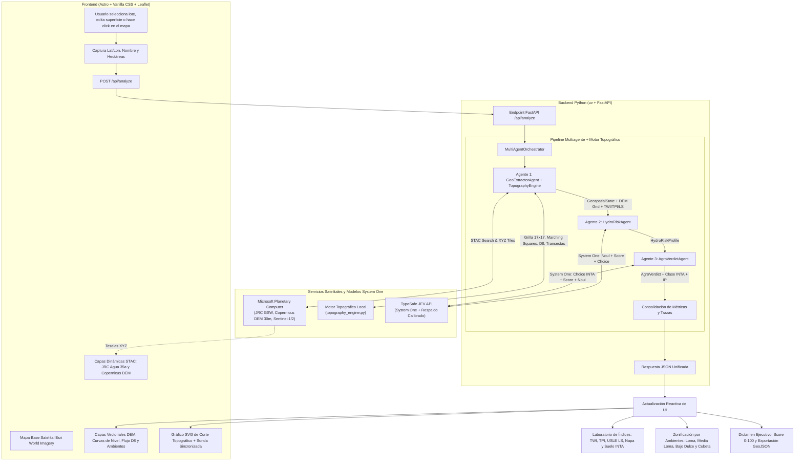

# AgroJEV PBA · Estudio Topográfico, Auditoría Hídrica y Evaluación de Terrenos Cultivables (Provincia de Buenos Aires)

Plataforma Full-Stack de alta precisión para **estudiar la topografía de terrenos rurales**, auditar parcelas agropecuarias y determinar su **aptitud agronómica**, **Capacidad de Uso INTA (Clases I a VIII)**, **zonificación por ambientes** y **vulnerabilidad a inundaciones o erosión hídrica** en la **Provincia de Buenos Aires, Argentina**.

El sistema combina datos satelitales abiertos de **Microsoft Planetary Computer STAC**, un **Motor Topográfico y Geomorfológico DEM** (curvas de nivel *Marching Squares*, vectores de escurrimiento D8, cortes topográficos con nivel freático e índices $\text{TWI}$, $\text{TPI}$ y $\text{USLE } LS$), el razonamiento tipado y calibrado de **TypeSafe JEV (System One)**, un backend asíncrono en **Python (`uv` + FastAPI)** y una interfaz web interactiva en **Astro + Leaflet**.

---

## Índice

1. [Problema que Resuelve y Contexto Hidro-Edáfico Pampeano](#1-problema-que-resuelve-y-contexto-hidro-edáfico-pampeano)
2. [Arquitectura General del Sistema](#2-arquitectura-general-del-sistema)
3. [Laboratorio Topográfico, Geomorfológico y de Ambientes](#3-laboratorio-topográfico-geomorfológico-y-de-ambientes)
   - [3.1. Mapa Topográfico Interactivo (Curvas de Nivel y Escurrimiento D8)](#31-mapa-topográfico-interactivo-curvas-de-nivel-y-escurrimiento-d8)
   - [3.2. Perfiles de Elevación / Cortes Topográficos con Nivel Freático](#32-perfiles-de-elevación--cortes-topográficos-con-nivel-freático)
   - [3.3. Índices Geomorfológicos, Hidrológicos y de Erosión](#33-índices-geomorfológicos-hidrológicos-y-de-erosión)
   - [3.4. Zonificación por Ambientes Productivos (Agricultura de Precisión)](#34-zonificación-por-ambientes-productivos-agricultura-de-precisión)
   - [3.5. Exportación Cartográfica GeoJSON para SIG (QGIS / ArcGIS)](#35-exportación-cartográfica-geojson-para-sig-qgis--arcgis)
4. [Fuentes de Datos Satelitales (Microsoft Planetary Computer)](#4-fuentes-de-datos-satelitales-microsoft-planetary-computer)
5. [Funcionamiento Detallado del Pipeline Multiagente con JEV](#5-funcionamiento-detallado-del-pipeline-multiagente-con-jev)
   - [Agente 1: Extractor Geoespacial y Motor Topográfico (`GeoExtractorAgent`)](#agente-1-extractor-geoespacial-y-motor-topográfico-geoextractoragent)
   - [Agente 2: Evaluador de Riesgo Hidrológico (`HydroRiskAgent`)](#agente-2-evaluador-de-riesgo-hidrológico-hydroriskagent)
   - [Agente 3: Clasificación INTA y Dictamen Agronómico (`AgroVerdictAgent`)](#agente-3-clasificación-inta-y-dictamen-agronómico-agroverdictagent)
   - [Orquestador Asíncrono (`MultiAgentOrchestrator`)](#orquestador-asíncrono-multiagentorchestrator)
6. [Frontend y Experiencia de Usuario (Astro + Leaflet)](#6-frontend-y-experiencia-de-usuario-astro--leaflet)
7. [Estructura del Proyecto](#7-estructura-del-proyecto)
8. [Guía de Instalación y Ejecución](#8-guía-de-instalación-y-ejecución)
9. [Casos de Estudio Reales en Buenos Aires](#9-casos-de-estudio-reales-en-buenos-aires)
10. [Especificación de la API REST](#10-especificación-de-la-api-rest)

---

## 1. Problema que Resuelve y Contexto Hidro-Edáfico Pampeano

La Provincia de Buenos Aires es una de las regiones agroproductivas más importantes del mundo, pero presenta marcadas complejidades topográficas, edáficas e hidrológicas donde **diferencias de apenas 50 centímetros de relieve determinan el éxito o la pérdida total de un cultivo**:
* **Pendientes mínimas o nulas (Pampa Deprimida):** En la Cuenca del Río Salado las pendientes suelen ser inferiores al $0.1\%$ ($< 1\text{ m/km}$), impidiendo la evacuación rápida de excedentes hídricos y favoreciendo suelos alcalino-sódicos (*Natraquoles* con horizonte $Bt$ nátrico).
* **Cuencas arreicas y endorreicas (Pampa Arenosa e Interserrana):** Abundancia de cordones medanosos longitudinales, bajos intermedanosos y cubetas de deflación donde el agua drena por infiltración o se acumula formando lagunas temporarias y ascenso de la napa freática.
* **Erosión hídrica en pendientes (Pampa Ondulada y Sistemas Serranos):** En el norte bonaerense (Pergamino, Arrecifes) y en los piedemontes de Tandilia y Ventania, las pendientes de $0.8\%$ a $>4\%$ generan escorrentía concentrada y pérdida de suelo superficial por erosión laminar y en surcos.
* **Variabilidad climática extrema:** La alternancia entre fases húmedas (*El Niño*) y secas (*La Niña*) exige conocer el micro-relieve y la posición de la napa freática antes de comprar, arrendar o sembrar un lote.

### ¿Por qué JEV (TypeSafe System One) y no un LLM tradicional?
Los modelos de lenguaje generativos tradicionales generan texto libre no estructurado y sufren de alucinaciones numéricas. **JEV** es un modelo de **System One** entrenado para emitir **juicios rápidos, tipados y matemáticamente calibrados**:
* Devuelve probabilidades reales ($P \in [0, 1]$) y distribuciones completas sobre opciones competitivas.
* Integra primitivas estrictas (`Noul`, `Score`, `Choice`) que el código backend consume de forma determinista y segura.
* Cuenta además con un motor de respaldo hidro-edáfico calibrado en `jev_service.py` para garantizar disponibilidad continua ante fallos de conectividad externa.

---

## 2. Arquitectura General del Sistema

El siguiente diagrama ilustra el flujo integral desde la selección o el trazado de un corte en el mapa hasta el modelado topográfico DEM, la consulta STAC y la inferencia multiagente en JEV:



---

## 3. Laboratorio Topográfico, Geomorfológico y de Ambientes

El módulo `backend/src/services/topography_engine.py` transforma las coordenadas y la superficie de la parcela en un estudio topográfico completo de ingeniería rural:

### 3.1. Mapa Topográfico Interactivo (Curvas de Nivel y Escurrimiento D8)
* **Malla Digital de Elevación Local ($17 \times 17$):** Genera una matriz de $289$ puntos altimétricos calibrada con la geomorfología real de la subregión bonaerense (lomadas de la Pampa Ondulada, cubetas de deflación de la Cuenca del Salado, médanos longitudinales del Oeste o valles serranos de Tandilia/Ventania).
* **Curvas de Nivel / Isolíneas (*Marching Squares*):**
  * Interpolación lineal sub-celda que genera polilíneas continuas de igual altitud ($\text{msnm}$).
  * **Equidistancia automática según el relieve:** `0.25 m` en la Pampa Deprimida (donde medio metro define el anegamiento), `0.5 m` en Pampa Arenosa/Interserrana, `1.0 m` en Pampa Ondulada y `5.0 m` en zonas serranas.
  * Diferenciación visual entre **curvas maestras** (trazo continuo con etiqueta de cota en metros sobre el mapa) y **curvas intermedias** (trazo discontinuo).
* **Vectores de Escurrimiento Superficial (Algoritmo D8):**
  * Calcula el gradiente bidimensional $(\partial z / \partial x, \partial z / \partial y)$ y propaga la acumulación de flujo desde las cotas superiores hacia las inferiores.
  * Dibuja flechas orientadas según el azimut de caída e identifica en color cian brillante las **vías de escurrimiento concentrado (*talwegs* / cañadas)**.

### 3.2. Perfiles de Elevación / Cortes Topográficos con Nivel Freático
* **3 Transectas Automáticas:**
  1. **Corte Norte → Sur (N–S)**
  2. **Corte Oeste → Este (O–E)**
  3. **Eje de Escurrimiento Dominante (Diagonal NO → SE)**
* **Modo Interactivo `📏 Trazar Corte Topográfico (A → B)` en el Mapa:**
  * Permite hacer click en cualquier **Punto A** y **Punto B** dentro del mapa para interpolar bilinealmente $25$ estaciones sobre la malla DEM y graficar al instante el corte longitudinal personalizado.
* **Doble Curva (Superficie + Napa Freática):**
  * Muestra simultáneamente la **cota superficial del terreno** (coloreada tramo a tramo según el ambiente edáfico) y la **cota estimada de la napa freática ($\text{msnm}$)**, permitiendo visualizar en qué depresiones la freática se acerca a la superficie o aflora.
* **Sonda Sincronizada Mapa ↔ Gráfico:** Al desplazar el cursor sobre el perfil SVG, un marcador sonda se mueve en vivo sobre el mapa satelital indicando distancia acumulada ($\text{m}$), cota ($\text{msnm}$), profundidad de napa ($\text{m}$) y pendiente local ($\%$).

### 3.3. Índices Geomorfológicos, Hidrológicos y de Erosión
Para cada lote auditado se calculan 6 indicadores técnicos fundamentales:
1. **Índice de Humedad Topográfica ($\text{TWI}$ - *Topographic Wetness Index*):**
   $$\text{TWI} = \ln\left(\frac{A_s}{\tan\beta}\right)$$
   Donde $A_s$ es el área de captación específica por unidad de contorno y $\beta$ el ángulo de pendiente. Valores $> 12.5$ alertan propensión severa a saturación hídrica; valores entre $8$ y $10$ indican óptima retención de humedad útil.
2. **Índice de Posición Topográfica ($\text{TPI}$ - *Topographic Position Index*):**
   $$\text{TPI} = z_0 - \bar{z}_{\text{entorno}}$$
   Mide en metros si el centro del lote se encuentra elevado respecto a sus vecinos ($\text{TPI} > 0$, *loma convexa emisora*) o deprimido ($\text{TPI} < 0$, *bajo o cubeta cóncava receptora*), acompañado de la **Amplitud de Relieve ($\Delta H = z_{\max} - z_{\min}$)**.
3. **Pendiente Media/Máxima ($\%$ y $^\circ$) y Orientación de Ladera (*Aspect*):**
   Calcula la pendiente en grados y en porcentaje ($\text{m de caída cada } 100\text{ m}$), el azimut dominante ($0^\circ\text{–}360^\circ$) y su efecto de insolación (*Solana cálida N/NO* vs. *Umbría fresca S/SO* o *Plano horizontal*).
4. **Factor Topográfico de Erosión Hídrica ($\text{USLE / RUSLE } LS$) y Rugosidad ($\text{TRI}$):**
   Estima el riesgo de pérdida laminar y en surcos por escorrentía superficial junto con el *Terrain Ruggedness Index* ($\text{m}$).
5. **Profundidad Estimada de Napa Freática ($\text{m}$) y Tipo de Red de Drenaje:**
   Clasifica la cuenca como **Exorreica definida**, **Endorreica / Arreica de cubetas** o **Arreica medanosa**.
6. **Taxonomía Edáfica Estimada (INTA):**
   Identifica el Gran Grupo taxonómico representativo de la subregión (*Argiudol típico*, *Natraquol típico / Natracualf*, *Hapludol éntico / thapto-árgico*, *Hapludol lítico / petrocálcico*).

### 3.4. Zonificación por Ambientes Productivos (Agricultura de Precisión)
Segmenta automáticamente la superficie total del lote (`area_ha`) en los **4 ambientes clásicos de manejo por ambientes**:
* 🟢 **Loma Alta Bien Drenada:** Suelo profundo y aireado, apto para cultivos exigentes (Maíz temprano, Soja 1ª, Trigo) con alta respuesta a fertilización.
* 🔵 **Media Loma de Transición:** Posición intermedia con excelente provisión de agua útil en años secos y buen drenaje en años normales.
* 🟡 **Bajo Tendido / Bajo Dulce:** Zona receptora de escorrentía con napa cercana; apta para cultivos tolerantes (Sorgo, Maíz tardío) o pasturas consociadas.
* 🔴 **Bajo Inundable / Cubeta Alcalina:** Depresión de acumulación hídrica o alcalinidad sódica (*horizonte Bt nátrico*); uso exclusivo ganadero (*Agropiro*, *Lotus tenuis*) o reserva hídrica.

### 3.5. Exportación Cartográfica GeoJSON para SIG (QGIS / ArcGIS)
El botón **`⬇️ Exportar GeoJSON Topográfico`** genera y descarga en el navegador un archivo estándar `.geojson` (`FeatureCollection`) que incluye:
* Todas las **curvas de nivel** (`MultiLineString`) con su propiedad `elevation_m` e indicador `is_major`.
* Todos los **vectores de escurrimiento D8** (`LineString`) con `azimuth_deg`, `slope_pct`, `flow_accumulation` e `is_drainage_channel`.
* El **centroide del lote** (`Point`) con el resumen completo de índices topográficos y dictamen JEV.

---

## 4. Fuentes de Datos Satelitales (Microsoft Planetary Computer)

El backend consulta en tiempo real el catálogo STAC (`https://planetarycomputer.microsoft.com/api/stac/v1`) y el servidor de teselas dinámicas (`https://planetarycomputer.microsoft.com/api/data/v1`):

1. **`jrc-gsw` (JRC Global Surface Water):** Serie histórica de más de 35 años de observaciones Landsat (1984–presente). Provee el porcentaje de recurrencia de agua superficial (`occurrence` $0\%\text{–}100\%$), máxima extensión histórica (`max_extent`) y estacionalidad (`permanente`, `estacional`, `efímero`, `seco`).
2. **`cop-dem-glo-30` (Copernicus DEM 30m):** Modelo Digital de Elevación global de la Agencia Espacial Europea (ESA) a 30 metros de resolución.
3. **`sentinel-1-rtc` (Radar SAR Sentinel-1):** Retrodispersión radar en Banda C ($\text{dB}$) capaz de atravesar nubes y detectar espejos de agua libre bajo vegetación ($< -16\text{ dB}$).
4. **`sentinel-2-l2a` (Óptico Multiespectral Sentinel-2):** Índice Diferencial de Agua Normalizado ($\text{NDWI}$) para monitoreo de humedad superficial.

---

## 5. Funcionamiento Detallado del Pipeline Multiagente con JEV

El sistema divide el procesamiento en tres agentes especializados y secuenciales coordinados por `MultiAgentOrchestrator`:

```text
[Coordenadas + Ha] ──> [Agente 1: STAC + Motor DEM] ──> [Agente 2: Riesgo Hídrico JEV] ──> [Agente 3: Clasificación INTA y Dictamen JEV]
```

### Agente 1: Extractor Geoespacial y Motor Topográfico (`GeoExtractorAgent`)
* **Archivos:** `backend/src/agents/geo_extractor.py`, `backend/src/services/planetary_stac.py`, `backend/src/services/topography_engine.py`
* **Misión:** Adquirir los metadatos STAC, generar las URLs de teselas dinámicas y ejecutar `build_topographic_analysis` para construir la grilla DEM, curvas de nivel, vectores D8, cortes de elevación, índices geomorfológicos y distribución de ambientes.
* **Salida Tipada:** `GeospatialState` (incluyendo el objeto anidado `TopographicAnalysisData`).

### Agente 2: Evaluador de Riesgo Hidrológico (`HydroRiskAgent`)
* **Archivo:** `backend/src/agents/hydro_risk.py`
* **Misión:** Evaluar la vulnerabilidad hídrica cruzando la recurrencia satelital JRC con los nuevos indicadores topográficos ($\text{TWI}$, $\text{TPI}$, profundidad de napa y distribución de bajos) mediante **JEV System One**:
  1. **`Noul` (`riesgo_severo`)**: Probabilidad calibrada $P \in [0.0, 1.0]$ de anegamiento crítico o persistente.
  2. **`Score` (`vulnerabilidad_topografica`)**: Posición ponderada entre `0` (*Loma alta / Drenaje excelente*) y `3` (*Depresión crítica / Acumulación severa*).
  3. **`Choice` (`mecanismo_hidrico`)**: Distribución de probabilidad entre `desborde_cuenca`, `escurrimiento_pluvial_lento`, `afloramiento_napa_freatica` y `sin_anegamiento`.
* **Salida Tipada:** `HydroRiskProfile`.

### Agente 3: Clasificación INTA y Dictamen Agronómico (`AgroVerdictAgent`)
* **Archivo:** `backend/src/agents/agro_verdict.py`
* **Misión:** Emitir la clasificación edáfica oficial y el plan de manejo productivo utilizando 6 primitivas simultáneas de **JEV System One**:
  1. **`Choice` (`aptitud`)**: `agricola_plena`, `mixto_agricola_ganadero`, `ganadero_pastizal_bajos` o `no_agricola_humedal`.
  2. **`Choice` (`clase_inta`)**: Clasificación en el sistema de **Capacidad de Uso de la Tierra del INTA / USDA**:
     * `clase_I_II`: **Clases I – II** (Agrícola sin limitaciones severas).
     * `clase_III_IV`: **Clases III – IV** (Agrícola condicional / requiere rotaciones y prácticas conservacionistas).
     * `clase_V_VI`: **Clases V – VI** (Ganadero / pasturas permanentes, no arable).
     * `clase_VII_VIII`: **Clases VII – VIII** (Reserva hídrica / humedal permanente sin uso arable).
  3. **`Choice` (`limitante_edafica`)**: Identificación de la subclase limitante dominante:
     * `sin_limitante` (**Subclase 0** · Sin limitantes críticas).
     * `exceso_hidrico_w` (**Subclase w** · Exceso hídrico y drenaje impedido).
     * `erosion_escorrentia_e` (**Subclase e** · Susceptibilidad a erosión hídrica por pendiente).
     * `salinidad_alcalinidad_s` (**Subclase s** · Alcalinidad sódica / horizonte $Bt$ nátrico / suelo somero).
  4. **`Score` (`resiliencia`)**: Estabilidad interanual frente a ciclos *El Niño / La Niña* (`0` a `2`).
  5. **`Noul` (`requiere_obras`)**: Probabilidad de requerir obras de drenaje, micro-canalización o curvas de nivel.
  6. **`Noul` (`manejo_ambientes`)**: Probabilidad de que la heterogeneidad del lote justifique **Agricultura de Precisión / Manejo Variable por Ambientes**.
* **Cálculo del Score Agrícola ($0\text{–}100$) e Índice de Productividad INTA ($\text{IP } 0\text{–}100$):**
  $$\text{Score} = \text{Base}(\text{Aptitud}) - (30 \times P_{\text{inundación}}) + (8 \times \text{Resiliencia})$$
  $$\text{IP}_{\text{INTA}} = 0.72 \times \text{Score} + 0.28 \times (\%\text{Loma Alta} + \%\text{Media Loma})$$
* **Salida Tipada:** `AgroVerdict`.

### Orquestador Asíncrono (`MultiAgentOrchestrator`)
* **Archivo:** `backend/src/orchestrator.py`
* Ejecuta la cadena `Agente 1 ➔ Agente 2 ➔ Agente 3` midiendo tiempos individuales (`duration_ms`) y devolviendo las trazas detalladas en `MultiAgentAnalysisResult`.

---

## 6. Frontend y Experiencia de Usuario (Astro + Leaflet)

La interfaz web (`frontend/src/`) está organizada en 4 paneles interactivos con estética *Glassmorphism*:
1. **`MapViewer.astro` (Visor Cartográfico Satelital y Topográfico):**
   * Selector de 5 zonas testigo de la Provincia de Buenos Aires + entradas de Nombre, Latitud, Longitud y **Superficie en hectáreas (`ha`)**.
   * Conmutador de modo de interacción: **`📍 Auditar Lote`** vs. **`📏 Trazar Corte Topográfico (A → B)`**.
   * Panel flotante de capas vectoriales y satelitales:
     * `〰️ Curvas de Nivel (Isolíneas)` con etiquetas de altitud en $\text{msnm}$.
     * `➡️ Vectores Escurrimiento D8` con flechas orientadas y canales de drenaje.
     * `🗺️ Zonificación por Ambientes` (grilla coloreada sobre el lote).
     * `📐 Línea de Corte Activa` (muestra en el mapa la traza `A ➔ B` del perfil seleccionado).
     * `💧 JRC Agua 35 años` y `⛰️ Copernicus DEM Regional`.
2. **`TopoStudyPanel.astro` (Laboratorio Topográfico, Geomorfológico y de Ambientes):**
   * **Gráfico SVG Interactivo de Corte Topográfico:** Pestañas para alternar entre `Corte N → S`, `Corte O → E`, `Eje NO → SE` y `Corte Libre A → B`, graficando cota superficial + nivel freático y sincronizando una sonda en vivo con el mapa.
   * **6 Tarjetas de Índices Geomorfológicos y Edáficos:** $\text{TWI}$, $\text{TPI}$, Pendiente y *Aspect*, Factor de Erosión $LS$ y $\text{TRI}$, Profundidad de Napa Freática y Taxonomía INTA.
   * **Distribución de Ambientes Productivos:** Barra apilada proporcional y tarjetas detalladas con porcentaje, hectáreas estimadas, cota media y recomendación de uso para Loma Alta, Media Loma, Bajo Dulce y Bajo Inundable.
   * **Botón `⬇️ Exportar GeoJSON Topográfico`.**
3. **`AgentMonitor.astro` (Monitor en Tiempo Real de los 3 Agentes):**
   * Muestra el estado de ejecución, cota y amplitud $\Delta H$, pendiente en $^\circ$ y $\%$, barra de probabilidad `Noul`, Capacidad de Uso INTA y Subclase limitante.
4. **`VerdictPanel.astro` (Dictamen Ejecutivo y Recomendaciones):**
   * Medidor circular animado (`0–100`), semáforo de riesgo, píldoras de **Capacidad INTA**, **Subclase Limitante** e **Índice de Productividad (IP)**, chips de cultivos recomendados, pautas de sistematización y botón **`📋 Copiar Informe`** técnico completo.

---

## 7. Estructura del Proyecto

```text
terreno_cultivable/
├── .env                              # Variable JEV_API_KEY
├── package.json                      # Scripts raíz para iniciar Backend + Frontend con un comando
├── README.md                         # Documentación técnica integral
│
├── backend/                          # Backend Python gestionado con uv
│   ├── pyproject.toml                # Dependencias (fastapi, typesafe-sdk, httpx, pydantic, uvicorn)
│   ├── uv.lock                       # Lockfile determinista
│   └── src/
│       ├── __init__.py
│       ├── main.py                   # Aplicación FastAPI y endpoints REST (/api/analyze, /api/presets)
│       ├── config.py                 # Configuración y carga de variables de entorno
│       ├── schemas.py                # Modelos Pydantic (Topografía, Perfiles, Geomorfo, Agentes)
│       ├── presets.py                # Ubicaciones testigo de la Provincia de Buenos Aires
│       ├── orchestrator.py           # Orquestador asíncrono del pipeline de 3 agentes
│       ├── services/
│       │   ├── planetary_stac.py     # Consulta STAC y teselas dinámicas de Microsoft Planetary Computer
│       │   ├── topography_engine.py  # Motor DEM 17x17, Marching Squares, Flujo D8, Cortes e Índices
│       │   └── jev_service.py        # Cliente JEV System One + motor calibrado de respaldo
│       └── agents/
│           ├── geo_extractor.py      # Agente 1: Extractor Satelital STAC + Topografía DEM
│           ├── hydro_risk.py         # Agente 2: Riesgo Hidrológico con JEV
│           └── agro_verdict.py       # Agente 3: Capacidad de Uso INTA y Dictamen Agronómico con JEV
│
└── frontend/                         # Aplicación Web moderna con Astro + Leaflet
    ├── package.json                  # Dependencias (astro, leaflet)
    ├── astro.config.mjs              # Configuración de Astro
    └── src/
        ├── layouts/
        │   └── Layout.astro          # Layout HTML base con tipografías Outfit, Inter y JetBrains Mono
        ├── styles/
        │   └── theme.css             # Sistema de diseño oscuro, tokens CSS y glassmorphism
        ├── components/
        │   ├── Header.astro          # Cabecera principal y estado de conexión con el backend
        │   ├── MapViewer.astro       # Visor Leaflet con controles de capas topográficas y modo transecta
        │   ├── TopoStudyPanel.astro  # Perfil de elevación SVG, 6 índices geomorfológicos y ambientes
        │   ├── AgentMonitor.astro    # Monitor en vivo de los 3 agentes JEV
        │   └── VerdictPanel.astro    # Score circular, Capacidad INTA, cultivos y copia de informe
        └── pages/
            └── index.astro           # Orquestación cliente, renderizado vectorial Leaflet y exportación GeoJSON
```

---

## 8. Guía de Instalación y Ejecución

### Prerrequisitos
* **Python 3.12+** y el gestor **`uv`** instalado (`curl -LsSf https://astral.sh/uv/install.sh | sh`).
* **Node.js 20+** y **`npm`**.
* Una clave API de TypeSafe (`JEV_API_KEY`) configurada en `.env` (si no se dispone de conexión o la clave expira, el sistema activa automáticamente su motor biofísico calibrado de respaldo).

### Paso 1: Instalar Dependencias (Primera vez)
```bash
npm run install:all
```

### Paso 2: Ejecución Rápida (Backend + Frontend en simultáneo)
Desde la **raíz del proyecto**, ejecuta:
```bash
npm run dev
```
Este comando levanta concurrentemente:
1. **Backend FastAPI**: `http://localhost:8000` (Documentación interactiva Swagger en `http://localhost:8000/docs`)
2. **Frontend Astro**: `http://localhost:4321`

---

## 9. Casos de Estudio Reales en Buenos Aires

| Indicador / Métrica | Caso A: Chascomús (Cuenca del Salado) | Caso B: Pergamino (Zona Núcleo) | Caso C: Pehuajó (Pampa Arenosa) | Caso D: Tandil (Sistema Serrano) |
| :--- | :--- | :--- | :--- | :--- |
| **Coordenadas** | `-35.5765, -58.0125` | `-33.8920, -60.5730` | `-35.8115, -61.8950` | `-37.3210, -59.1330` |
| **Unidad Geomorfológica** | Pampa Deprimida / Cuenca Baja del Salado | Pampa Ondulada (Zona Núcleo Norte) | Pampa Arenosa (Oeste Bonaerense) | Sistema Serrano de Tandilia |
| **Taxonomía Edáfica INTA** | *Natraquol típico / Natracualf* (Bt nátrico) | *Argiudol típico* (Serie Pergamino) | *Hapludol éntico / thapto-árgico* | *Argiudol típico / Hapludol lítico* |
| **Cota y Amplitud ($\Delta H$)** | `18.2–20.0 msnm` ($\Delta H = 1.81\text{ m}$) | `54.5–73.3 msnm` ($\Delta H = 18.89\text{ m}$) | `91.6–97.3 msnm` ($\Delta H = 5.72\text{ m}$) | `325.6–428.4 msnm` ($\Delta H = 102.8\text{ m}$) |
| **Pendiente Media** | `0.05°` (`0.10%`) | `0.70°` (`0.71%`) | `0.21°` (`0.43%`) | `3.50°` (`4.15%`) |
| **Equidistancia Curvas** | `0.25 m` | `1.0 m` | `0.5 m` | `5.0 m` |
| **Índice Humedad ($\text{TWI}$)** | `17.39` (Saturación severa) | `11.53` (Humedad equilibrada) | `13.46` (Acumulación en bajos) | `9.66` (Drenaje rápido) |
| **Factor Erosión ($\text{USLE } LS$)** | `0.11` (Nulo) | `0.15` (Bajo) | `0.13` (Bajo) | `0.85` (Moderado-Alto) |
| **Napa Freática Estimada** | `0.70 m` (Muy superficial) | `4.27 m` (Profunda y segura) | `1.07 m` (Cercana en bajos) | `8.08 m` (Profunda) |
| **Distribución de Ambientes** | `51.9%` Bajo Inundable / `26.0%` Bajo Dulce | `43.3%` Loma Alta / `40.1%` Media Loma | `27.0%` Media Loma / `54.6%` Bajos | `33.9%` Loma Alta / `48.8%` Media Loma |
| **Capacidad de Uso INTA** | **Clases VII – VIII** (`Subclase w`) | **Clases I – II** (`Subclase 0`) | **Clases III – IV** (`Subclase s`) | **Clases III – IV** (`Subclase e`) |
| **Score Agrícola / IP INTA** | **5 / 100** (`IP 10` · Rojo) | **98 / 100** (`IP 94` · Verde) | **65 / 100** (`IP 59` · Amarillo) | **98 / 100** (`IP 94` · Verde) |

---

## 10. Especificación de la API REST

### `POST /api/analyze`
Ejecuta el pipeline multiagente y el motor topográfico para una coordenada y superficie en hectáreas.

**Cuerpo de la Petición (`application/json`):**
```json
{
  "lat": -35.5765,
  "lon": -58.0125,
  "parcel_name": "Campo El Trébol - Chascomús",
  "area_ha": 120.0
}
```

**Estructura Resumida de la Respuesta (`200 OK`):**
```json
{
  "request": {
    "lat": -35.5765,
    "lon": -58.0125,
    "parcel_name": "Campo El Trébol - Chascomús",
    "area_ha": 120.0
  },
  "geospatial": {
    "elevation_m": 19.3,
    "slope_deg": 0.05,
    "slope_pct": 0.1,
    "relative_depression_score": 0.82,
    "jrc_occurrence_pct": 48.3,
    "sar_backscatter_db": -17.5,
    "sentinel2_ndwi": 0.28,
    "tile_layers": [ "..." ],
    "topography": {
      "grid_lats": [ "..." ],
      "grid_lons": [ "..." ],
      "elevation_grid": [ ["..."] ],
      "zone_grid": [ ["..."] ],
      "water_table_base_msnm": 18.23,
      "geomorphology": {
        "region_geomorphology": "Pampa Deprimida / Cuenca Baja del Río Salado",
        "soil_taxonomy_inta": "Natraquol típico / Natracualf (Horizonte Bt nátrico impermeable, alcalino en bajos)",
        "drainage_network_type": "Endorreica / Arreica laminar con cubetas de deflación y lagunas encadenadas",
        "slope_pct": 0.1,
        "max_slope_pct": 0.24,
        "min_elevation_m": 18.17,
        "max_elevation_m": 19.98,
        "relief_amplitude_m": 1.81,
        "contour_interval_m": 0.25,
        "twi_value": 17.39,
        "twi_label": "Muy Alto (>12.5) · Propensión severa a saturación y anegamiento",
        "tpi_value_m": -0.62,
        "tpi_label": "Cubeta cóncava / Depresión de acumulación",
        "tri_rugosity_m": 0.11,
        "aspect_deg": 142.5,
        "aspect_cardinal": "SE (Fresca húmeda)",
        "ls_erosion_factor": 0.11,
        "erosion_risk_label": "Bajo / Nulo (Predomina sedimentación e hidromorfismo sobre erosión)",
        "estimated_water_table_depth_m": 0.7
      },
      "terrain_zones": [
        {
          "zone_id": "loma_alta",
          "zone_name": "Loma Alta Bien Drenada",
          "percentage": 6.2,
          "area_ha": 7.4,
          "mean_elevation_m": 19.82,
          "color_hex": "#10b981",
          "agronomic_use": "Suelo profundo y aireado..."
        }
      ],
      "contours": [
        {
          "elevation_m": 18.5,
          "is_major": true,
          "polylines": [ [ [-35.581, -58.018], [-35.579, -58.015] ] ]
        }
      ],
      "flow_vectors": [
        {
          "lat": -35.5765,
          "lon": -58.0125,
          "target_lat": -35.5774,
          "target_lon": -58.0116,
          "azimuth_deg": 135.2,
          "slope_pct": 0.14,
          "flow_accumulation": 8,
          "is_drainage_channel": true
        }
      ],
      "elevation_profiles": [
        {
          "profile_id": "north_south",
          "title": "Transecta Norte → Sur (N-S)",
          "total_distance_m": 2168.4,
          "min_elevation_m": 18.25,
          "max_elevation_m": 19.64,
          "relief_delta_m": 1.39,
          "avg_slope_pct": 0.06,
          "max_slope_pct": 0.21,
          "points": [ "..." ]
        }
      ]
    }
  },
  "hydro_risk": {
    "riesgo_inundacion_severo_prob": 0.841,
    "vulnerabilidad_topografica_score": 3,
    "vulnerabilidad_topografica_label": "Depresión crítica / Acumulación severa",
    "mecanismo_hidrico_dominante": "escurrimiento_pluvial_lento",
    "mecanismo_hidrico_label": "Estancamiento pluvial por escasa pendiente",
    "confidence": 0.92,
    "resumen_hidrologico": "Riesgo hídrico crítico (84%). Sujeto a estancamiento pluvial por escasa pendiente con drenaje deficiente (TWI 17.39)."
  },
  "verdict": {
    "aptitud_productiva": "no_agricola_humedal",
    "aptitud_productiva_label": "No Cultivable (Cuerpo de Agua / Reserva Hídrica)",
    "clase_capacidad_uso_inta": "clase_VII_VIII",
    "clase_capacidad_uso_label": "Clases VII – VIII (Reserva hídrica / Sin uso arable)",
    "limitante_edafica_codigo": "exceso_hidrico_w",
    "limitante_edafica_label": "Subclase w · Exceso hídrico y drenaje impedido",
    "indice_productividad_ip": 10,
    "manejo_por_ambientes_recomendado": true,
    "manejo_por_ambientes_prob": 0.6,
    "score_aptitud_agricola": 5,
    "color_semaforo": "rojo",
    "dictamen_ejecutivo": "Lote con limitación hídrica severa (5/100 · IP INTA ~10)...",
    "recomendaciones_agronomicas": [ "..." ],
    "cultivos_sugeridos": [ "Vegetación hidrófila natural", "Pastizal natural de bajo (manejo estacional)" ]
  },
  "traces": [ "..." ],
  "execution_time_total_ms": 845.2
}
```

---

## 11. Licencia y Créditos

* **Datos Satelitales:** Microsoft Planetary Computer STAC, European Commission Joint Research Centre (JRC), Agencia Espacial Europea (ESA) Copernicus.
* **Inteligencia de Decisión:** [TypeSafe AI](https://typesafe.ai) System One Model Jev.
* **Desarrollado para:** Estudio topográfico, clasificación edáfica INTA y evaluación hidro-productiva en la Provincia de Buenos Aires, Argentina.
