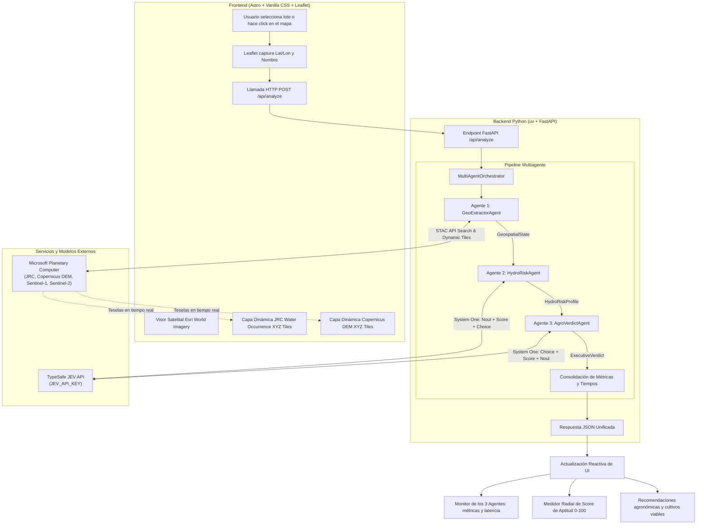

# AgroJEV PBA · Auditoría Hídrica y Evaluación de Terrenos Cultivables (Provincia de Buenos Aires)

Plataforma Full-Stack de alta precisión para auditar parcelas agropecuarias y determinar su **aptitud agronómica** y su **vulnerabilidad a inundaciones y anegamientos** en la **Provincia de Buenos Aires, Argentina**.

El sistema integra la potencia de datos satelitales abiertos de **Microsoft Planetary Computer STAC**, el razonamiento tipado y calibrado de **TypeSafe JEV (System One)**, un backend reactivo en **Python (`uv` + FastAPI)** y una interfaz web moderna en **Astro** con cartografía interactiva en **Leaflet**.

---

## Índice

1. [Problema que Resuelve y Contexto Pampeano](#1-problema-que-resuelve-y-contexto-pampeano)
2. [Arquitectura General del Sistema](#2-arquitectura-general-del-sistema)
3. [Fuentes de Datos Satelitales (Microsoft Planetary Computer)](#3-fuentes-de-datos-satelitales-microsoft-planetary-computer)
4. [Funcionamiento Detallado del Pipeline Multiagente con JEV](#4-funcionamiento-detallado-del-pipeline-multiagente-con-jev)
   - [Agente 1: Extractor Geoespacial (`GeoExtractorAgent`)](#agente-1-extractor-geoespacial-geoextractoragent)
   - [Agente 2: Evaluador de Riesgo Hidrológico (`HydroRiskAgent`)](#agente-2-evaluador-de-riesgo-hidrológico-hydroriskagent)
   - [Agente 3: Dictamen y Aptitud Agronómica (`AgroVerdictAgent`)](#agente-3-dictamen-y-aptitud-agronómica-agroverdictagent)
   - [Orquestador Asíncrono (`MultiAgentOrchestrator`)](#orquestador-asíncrono-multiagentorchestrator)
5. [Frontend y Experiencia de Usuario (Astro + Leaflet)](#5-frontend-y-experiencia-de-usuario-astro--leaflet)
6. [Estructura del Proyecto](#6-estructura-del-proyecto)
7. [Guía de Instalación y Ejecución](#7-guía-de-instalación-y-ejecución)
8. [Casos de Estudio Reales en Buenos Aires](#8-casos-de-estudio-reales-en-buenos-aires)
9. [Especificación de la API REST](#9-especificación-de-la-api-rest)

---

## 1. Problema que Resuelve y Contexto Pampeano

La Provincia de Buenos Aires es una de las regiones agroproductivas más importantes del mundo, pero presenta marcadas complejidades hidrológicas:
* **Pendientes mínimas o nulas:** En la Pampa Deprimida (Cuenca del Río Salado) las pendientes suelen ser inferiores al 0.05% (50 cm por kilómetro), dificultando el escurrimiento natural de las aguas superficiales.
* **Cuencas arreicas y endorreicas:** Abundancia de cubetas de deflación y cañadas donde el agua de lluvia no desemboca en ríos principales, sino que se acumula formando lagunas estacionales.
* **Variabilidad climática extrema:** La alternancia entre ciclos húmedos (*El Niño*) y secos (*La Niña*) provoca que campos que lucen secos y cultivables en épocas de sequía queden totalmente anegados durante años húmedos.

### ¿Por qué JEV (TypeSafe System One) y no un LLM tradicional?
Los modelos de lenguaje generativos tradicionales generan texto libre no estructurado y sufren de alucinaciones numéricas. **JEV** es un modelo de **System One** entrenado para emitir **juicios rápidos, tipados y matemáticamente calibrados**:
* Devuelve probabilidades reales ($P \in [0, 1]$) y niveles de confianza estadística.
* Integra primitivas estrictas (`Noul`, `Score`, `Choice`) que el código backend consume de forma determinista y segura.

---

## 2. Arquitectura General del Sistema

El siguiente diagrama ilustra el flujo de datos integral desde la interacción del usuario en el navegador hasta la resolución en las APIs de Microsoft y TypeSafe:



---

## 3. Fuentes de Datos Satelitales (Microsoft Planetary Computer)

El backend interactúa directamente con el endpoint STAC (`https://planetarycomputer.microsoft.com/api/stac/v1`) y el servidor de teselas dinámicas (`https://planetarycomputer.microsoft.com/api/data/v1`). No requiere descargar archivos pesados; utiliza el estándar **Cloud-Optimized GeoTIFF (COG)**:

### 1. `jrc-gsw` (JRC Global Surface Water)
* **Origen:** Centro Común de Investigación de la Comisión Europea (JRC), basado en observaciones históricas de satélites Landsat 5, 7 y 8 desde 1984 hasta la actualidad (más de 35 años de serie temporal continua).
* **Capas utilizadas:**
  * `occurrence`: Porcentaje de veces que se detectó agua sobre la superficie entre 0% y 100%. Permite identificar si un lote aparentemente seco estuvo bajo agua durante las grandes inundaciones pampeanas de 1993, 2001, 2012 o 2017.
  * `max_extent`: Booleano que indica la máxima extensión histórica registrada.
  * `seasonality`: Clasificación en agua permanente, estacional, efímera o suelo seco.
* **Teselas Dinámicas:** Proyectadas en el mapa con mapa de color continuo `jrc-occurrence`.

### 2. `cop-dem-glo-30` (Copernicus DEM 30m)
* **Origen:** Modelo Digital de Elevación global del programa espacial europeo Copernicus a 30 metros de resolución espacial.
* **Utilidad:** Provee la cota altimétrica precisa sobre el nivel medio del mar (msnm), permitiendo calcular la pendiente del terreno, el micro-relieve relativo y las líneas de escurrimiento.

### 3. `sentinel-1-rtc` (Radar SAR Sentinel-1)
* **Origen:** Radar de Apertura Sintética (SAR) en Banda C a 10 metros de resolución.
* **Principio físico:** Las microondas del radar **atraviesan la cobertura nubosa y la lluvia**. Cuando la superficie está inundada, el agua calma actúa como un espejo reflector especular dispersando la energía lejos de la antena, lo que produce una retrodispersión muy baja (valores inferiores a -16 dB en polarización VV/VH), distinguiendo el agua libre de cultivos normales (-10 dB a -13 dB).

### 4. `sentinel-2-l2a` (Óptico Multiespectral Sentinel-2)
* **Bandas e índices:** Banda verde (B03), infrarrojo cercano NIR (B08) e infrarrojo de onda corta SWIR (B11) para calcular el **NDWI** (Índice Diferencial de Agua Normalizado) y **MNDWI** (Índice Modificado de Agua), complementado con la capa de clasificación de escena nativa `SCL`.

---

## 4. Funcionamiento Detallado del Pipeline Multiagente con JEV

El sistema divide el análisis en tres agentes especializados y secuenciales:

```text
[Coordenadas] ──> [Agente 1: Geoespacial] ──> [Agente 2: Riesgo JEV] ──> [Agente 3: Dictamen JEV] ──> [Reporte]
```

---

### Agente 1: Extractor Geoespacial (`GeoExtractorAgent`)
* **Archivo:** `backend/src/agents/geo_extractor.py`
* **Misión:** Adquirir los parámetros biofísicos y generar los vínculos a las teselas cartográficas.
* **Proceso:**
  1. Calcula un *bounding box* alrededor de las coordenadas ingresadas.
  2. Consulta la API STAC de Microsoft Planetary Computer (`search` sobre `jrc-gsw` y `cop-dem-glo-30`).
  3. Modela la geomorfología y cota regional según la subcuenca de la Provincia de Buenos Aires (Pampa Ondulada, Pampa Deprimida / Cuenca del Salado, Pampa Arenosa o Sistema Serrano).
  4. Genera las URLs de teselas XYZ dinámicas para alimentar el mapa de Leaflet.
* **Salida Tipada (`GeospatialState`):**
  * `elevation_m`: Cota en metros sobre el nivel del mar.
  * `slope_deg`: Pendiente estimada en grados.
  * `relative_depression_score`: Índice de 0.0 (loma alta) a 1.0 (cubeta cerrada de acumulación).
  * `jrc_occurrence_pct`: Porcentaje histórico de presencia de agua (0% a 100%).
  * `sar_backscatter_db`: Valor de retrodispersión radar de referencia.
  * `tile_layers`: Lista de capas dinámicas STAC para el mapa.

---

### Agente 2: Evaluador de Riesgo Hidrológico (`HydroRiskAgent`)
* **Archivo:** `backend/src/agents/hydro_risk.py`
* **Misión:** Evaluar la vulnerabilidad hídrica aplicando la lógica de decisión de **JEV System One**.
* **Primitivas JEV utilizadas:**
  1. **`Noul` (`riesgo_severo`)**:
     * *Instrucción:* Evalúa si las condiciones topográficas e históricas implican alta probabilidad de anegamiento crítico o persistente bajo ciclos húmedos en Buenos Aires.
     * *Resultado:* Probabilidad calibrada $P \in [0.0, 1.0]$ (ej: Chascomús = 0.81, Pergamino = 0.11).
  2. **`Score` (`vulnerabilidad_topografica`)**:
     * *Criterios ordenados:*
       * `0`: Loma alta con pendiente óptima y drenaje natural excelente.
       * `1`: Plano suave con escurrimiento moderado a lento.
       * `2`: Bajo suave o cubeta intermedia susceptible a anegamiento temporario.
       * `3`: Depresión crítica, cañada o cubeta cerrada con acumulación severa.
     * *Resultado:* Nivel ordinal ponderado continuo y etiqueta diagnóstica.
  3. **`Choice` (`mecanismo_hidrico`)**:
     * *Opciones excluyentes:*
       * `desborde_cuenca`: Desborde de ríos, arroyos o lagunas encadenadas.
       * `escurrimiento_pluvial_lento`: Estancamiento local por pendiente casi nula y lluvias locales.
       * `afloramiento_napa_freatica`: Saturación por napa freática alta muy cercana a la superficie.
       * `sin_anegamiento`: Posición topográfica de loma protegida.
     * *Resultado:* Opción dominante, distribución completa de probabilidades y nivel de confianza estadística.
* **Salida Tipada (`HydroRiskProfile`):** Objeto que encapsula la probabilidad, el score topográfico, el mecanismo dominante y el resumen hidrológico.

---

### Agente 3: Dictamen y Aptitud Agronómica (`AgroVerdictAgent`)
* **Archivo:** `backend/src/agents/agro_verdict.py`
* **Misión:** Transformar el diagnóstico hidrológico en una recomendación agronómica y productiva concreta.
* **Primitivas JEV utilizadas:**
  1. **`Choice` (`aptitud`)**:
     * *Opciones:*
       * `agricola_plena`: Apto agricultura continua (soja, maíz temprano, trigo/soja 2ª, girasol, cebada).
       * `mixto_agricola_ganadero`: Apto rotación agrícola con pasturas consociadas (alfalfa, festuca, sorgo).
       * `ganadero_pastizal_bajos`: Apto ganadería de cría y recría sobre pastizales naturales de bajos (Lotus, agropiro).
       * `no_agricola_humedal`: Inapto para laboreo agrícola / cuerpo de agua permanente o reserva de cuenca.
  2. **`Score` (`resiliencia`)**:
     * Grado de estabilidad interanual frente a la alternancia de eventos Niño/Niña (Muy vulnerable / Resiliencia media / Alta resiliencia).
  3. **`Noul` (`requiere_obras`)**:
     * Probabilidad calibrada de requerir inversiones en obras de drenaje, zanjeo de alivio o curvas de nivel para cultivar de forma sustentable.
* **Algoritmo de Score Agrícola (0 - 100):**
  $$\text{Score} = \text{Base}(\text{Aptitud}) - (30 \times P_{\text{inundación}}) + (8 \times \text{Resiliencia})$$
  * Clasifica el resultado en un semáforo visual: **Verde** ($\ge 75$), **Amarillo** ($45 - 74$), **Rojo** ($< 45$).
  * Genera el listado específico de especies/cultivos viables y las pautas de manejo agronómico.

---

### Orquestador Asíncrono (`MultiAgentOrchestrator`)
* **Archivo:** `backend/src/orchestrator.py`
* Coordina la invocación `Agente 1 ➔ Agente 2 ➔ Agente 3` de manera completamente asíncrona (`asyncio`).
* Registra trazas de ejecución con tiempos de respuesta en milisegundos (`duration_ms`), garantizando trazabilidad y diagnósticos en menos de 2.5 segundos por evaluación completa.

---

## 5. Frontend y Experiencia de Usuario (Astro + Leaflet)

El frontend está desarrollado en **Astro v5** aprovechando su arquitectura basada en componentes ligeros y tiempos de carga instantáneos:
* **Mapa Leaflet Satelital:**
  * Centrado en la Provincia de Buenos Aires con capa base satelital de alta resolución (Esri World Imagery).
  * Marcador interactivo que permite hacer click en cualquier coordenada para disparar la auditoría.
  * Toggles para activar/desactivar las teselas dinámicas de **JRC Agua Histórica** y **Copernicus DEM** superpuestas sobre el satélite.
* **Barra de Presets Rápidos:** Botones de acceso inmediato a localidades con características hídricas contrastantes de la provincia.
* **Monitor Multiagente en Tiempo Real:** Tarjetas dinámicas que reflejan el estado de cada agente (Listo / Procesando / Completado) con sus métricas clave.
* **Medidor Circular de Aptitud (0 a 100):** Gráfico SVG animado que refleja el score agronómico y se ilumina en verde, ámbar o rojo según el riesgo.
* **Exportación Rápida:** Botón para copiar al portapapeles el dictamen ejecutivo estructurado.
* **Diseño Glassmorphism y Paleta Oscura:** Diseñado en Vanilla CSS puro con variables de diseño, tipografías *Outfit* e *Inter*, y desenfoques `backdrop-filter: blur(16px)`.

---

## 6. Estructura del Proyecto

```text
terreno_cultivable/
├── .env                          # Variable JEV_API_KEY
├── README.md                     # Documentación técnica exhaustiva
│
├── backend/                      # Backend Python gestionado con uv
│   ├── pyproject.toml            # Dependencias oficiales (fastapi, typesafe-sdk, httpx)
│   ├── uv.lock                   # Lockfile determinista de dependencias
│   └── src/
│       ├── __init__.py
│       ├── main.py               # Aplicación FastAPI y rutas REST
│       ├── config.py             # Lectura de variables de entorno (JEV_API_KEY)
│       ├── schemas.py            # Modelos Pydantic (Request, States, Responses)
│       ├── presets.py            # Ubicaciones preconfiguradas de Buenos Aires
│       ├── orchestrator.py       # Orquestador del pipeline multiagente
│       ├── services/
│       │   ├── planetary_stac.py # Integración con STAC y Data API de Microsoft
│       │   └── jev_service.py    # Cliente JEV con AsyncTypeSafeClient
│       └── agents/
│           ├── geo_extractor.py  # Agente 1: Extractor Satelital STAC
│           ├── hydro_risk.py     # Agente 2: Riesgo Hidrológico con JEV
│           └── agro_verdict.py   # Agente 3: Dictamen y Aptitud con JEV
│
└── frontend/                     # Aplicación Web moderna con Astro
    ├── package.json              # Dependencias (astro, leaflet, @types/leaflet)
    ├── astro.config.mjs          # Configuración de Astro
    └── src/
        ├── layouts/
        │   └── Layout.astro      # Layout HTML base con tipografías y estilos
        ├── styles/
        │   └── theme.css         # Tokens de diseño, colores, glassmorphism
        ├── components/
        │   ├── Header.astro      # Cabecera con estado de conexión del backend
        │   ├── MapViewer.astro   # Contenedor del mapa Leaflet, presets y controles
        │   ├── AgentMonitor.astro# Visualizador del pipeline de los 3 agentes
        │   └── VerdictPanel.astro# Medidor circular de score, cultivos y dictamen
        └── pages/
            └── index.astro       # Página principal que orquesta el cliente
```

---

## 7. Guía de Instalación y Ejecución

### Prerrequisitos
* **Python 3.12+** y el gestor **`uv`** instalado (`curl -LsSf https://astral.sh/uv/install.sh | sh`).
* **Node.js 20+** y **`npm`**.
* Una clave API de TypeSafe (`JEV_API_KEY`).

### Paso 1: Configurar la Clave API
Asegúrate de que en la raíz del proyecto exista el archivo `.env`:
```env
JEV_API_KEY=tu_api_key_de_typesafe
```

### Paso 2: Ejecución Rápida (Recomendada: Todo en un solo comando)
Desde la **raíz del proyecto**, ejecuta:
```bash
npm run dev
```
Este comando inicia concurrentemente:
1. **Backend FastAPI**: en `http://localhost:8000` (con hot-reload activado)
2. **Frontend Astro**: en `http://localhost:4321`

Al presionar `Ctrl + C`, ambos servicios se detienen limpiamente de forma simultánea.

---

### Alternativa: Iniciar Servicios por Separado

Si prefieres ejecutar cada servicio en terminales independientes:

* **Backend únicamente (FastAPI + uv):**
  ```bash
  # Desde la raíz:
  npm run dev:backend
  # O directamente:
  cd backend && uv run uvicorn src.main:app --host 0.0.0.0 --port 8000 --reload
  ```
  * API: `http://localhost:8000`
  * Swagger Docs: `http://localhost:8000/docs`
  * Health check: `http://localhost:8000/api/health`

* **Frontend únicamente (Astro):**
  ```bash
  # Desde la raíz:
  npm run dev:frontend
  # O directamente:
  cd frontend && npm run dev
  ```
  * Interfaz Web: `http://localhost:4321`

---

## 8. Casos de Estudio Reales en Buenos Aires

El comportamiento contrastante del sistema se verifica en zonas con geomorfologías opuestas dentro de la provincia:

### Caso A: Cuenca Baja del Río Salado (Chascomús)
* **Coordenadas:** `-35.5765, -58.0125`
* **Datos STAC:** Cota 19.3 msnm, pendiente 0.05°, recurrencia histórica de agua JRC = **48.3%**, retrodispersión SAR = **-17.5 dB** (agua especular).
* **Diagnóstico JEV:**
  * `Noul` Riesgo Severo = **0.81** (Crítico).
  * Mecanismo dominante = *Estancamiento pluvial por escasa pendiente*.
* **Dictamen Agronómico:**
  * Aptitud = *No Cultivable (Cuerpo de Agua / Reserva Hídrica)*.
  * Score Agrícola = **5 / 100** (Semáforo Rojo).
  * Dictamen: Prohibido laboreo agrícola; zona de retención de cuenca.

### Caso B: Zona Núcleo Agrícola (Pergamino)
* **Coordenadas:** `-33.8920, -60.5730`
* **Datos STAC:** Cota 63.7 msnm, pendiente 0.7°, recurrencia histórica de agua JRC = **0.0%**, retrodispersión SAR = **-11.8 dB** (cobertura vegetal).
* **Diagnóstico JEV:**
  * `Noul` Riesgo Severo = **0.11** (Mínimo).
  * Posición topográfica = *Loma alta con drenaje excelente*.
* **Dictamen Agronómico:**
  * Aptitud = *Apto Agricultura Continua (Alta Productividad)*.
  * Score Agrícola = **98 / 100** (Semáforo Verde).
  * Cultivos sugeridos: Soja de 1ª, Maíz temprano, Trigo/Soja 2ª, Girasol.

### Caso C: Pampa Arenosa (Pehuajó)
* **Coordenadas:** `-35.8115, -61.8950`
* **Datos STAC:** Cota 94.5 msnm, relieve plano con médanos y bajos intermedios, recurrencia histórica de agua = **11.8%**.
* **Diagnóstico JEV:**
  * `Noul` Riesgo Severo = **0.45** (Moderado).
* **Dictamen Agronómico:**
  * Aptitud = *Apto Ganadería de Cría (Pastizal Natural de Bajos)*.
  * Score Agrícola = **25 / 100** (Semáforo Rojo para cultivo fino, viable para ganadería).
  * Especies recomendadas: *Lotus tenuis*, *Agropiro alargado*, *Festuca arundinacea*.

### Caso D: Sistema Serrano (Tandil)
* **Coordenadas:** `-37.3210, -59.1330`
* **Datos STAC:** Cota 374.9 msnm, pendiente 3.5°, recurrencia histórica de agua = **0.0%**.
* **Diagnóstico JEV:**
  * `Noul` Riesgo Severo = **0.11**.
  * Mecanismo dominante = *Zona alta protegida de anegamientos*.
* **Dictamen Agronómico:**
  * Aptitud = *Apto Agricultura Continua*.
  * Score Agrícola = **98 / 100** (Semáforo Verde).

---

## 9. Especificación de la API REST

### `POST /api/analyze`
Ejecuta el pipeline multiagente para auditar una coordenada geográfica.

**Cuerpo de la Petición (`application/json`):**
```json
{
  "lat": -35.5765,
  "lon": -58.0125,
  "parcel_name": "Campo El Trébol - Chascomús",
  "area_ha": 150.0
}
```

**Respuesta Exitosa (`200 OK`):**
```json
{
  "request": {
    "lat": -35.5765,
    "lon": -58.0125,
    "parcel_name": "Campo El Trébol - Chascomús",
    "area_ha": 150.0
  },
  "geospatial": {
    "elevation_m": 19.3,
    "slope_deg": 0.05,
    "relative_depression_score": 0.82,
    "jrc_occurrence_pct": 48.3,
    "jrc_max_extent": true,
    "jrc_seasonality": "permanente",
    "sar_backscatter_db": -17.5,
    "sentinel2_ndwi": 0.28,
    "tile_layers": [
      {
        "name": "jrc_water_occurrence",
        "title": "Recurrencia Histórica de Agua (JRC 35+ años)",
        "tile_url": "https://planetarycomputer.microsoft.com/api/data/v1/item/tiles/WebMercatorQuad/{z}/{x}/{y}@1x?collection=jrc-gsw&item=60W_30Sv1_3_2020&assets=occurrence&colormap_name=jrc-occurrence&nodata=0&format=png"
      }
    ]
  },
  "hydro_risk": {
    "riesgo_inundacion_severo_prob": 0.81,
    "vulnerabilidad_topografica_score": 3,
    "vulnerabilidad_topografica_label": "Depresión crítica / Acumulación severa",
    "mecanismo_hidrico_dominante": "escurrimiento_pluvial_lento",
    "mecanismo_hidrico_label": "Estancamiento pluvial por escasa pendiente",
    "confidence": 0.95,
    "resumen_hidrologico": "Riesgo hídrico crítico (81%). Sujeto a estancamiento pluvial con drenaje deficiente."
  },
  "verdict": {
    "aptitud_productiva": "no_agricola_humedal",
    "aptitud_productiva_label": "No Cultivable (Cuerpo de Agua / Reserva Hídrica)",
    "resiliencia_climatica_score": 0,
    "resiliencia_climatica_label": "Muy vulnerable a excesos hídricos (Ciclos El Niño)",
    "requiere_obras_drenaje": true,
    "requiere_obras_prob": 0.89,
    "score_aptitud_agricola": 5,
    "color_semaforo": "rojo",
    "dictamen_ejecutivo": "Lote con limitación hídrica severa (5/100). Comportamiento de cubeta o humedal permanente. Restricción absoluta para laboreo.",
    "recomendaciones_agronomicas": [
      "Preservar como zona de retención hídrica natural y refugio de biodiversidad.",
      "No realizar movimientos de suelo que alteren el drenaje regional de la cuenca."
    ],
    "cultivos_sugeridos": ["Vegetación hidrófila natural"]
  },
  "traces": [
    { "agent_id": "agent_1_geo_extractor", "duration_ms": 210.4, "status": "completed" },
    { "agent_id": "agent_2_hydro_risk", "duration_ms": 780.2, "status": "completed" },
    { "agent_id": "agent_3_agro_verdict", "duration_ms": 820.5, "status": "completed" }
  ],
  "execution_time_total_ms": 1815.2
}
```

---

## 10. Licencia y Créditos

* **Datos Satelitales:** Microsoft Planetary Computer STAC, European Commission Joint Research Centre (JRC), Agencia Espacial Europea (ESA) Copernicus.
* **Inteligencia de Decisión:** [TypeSafe AI](https://typesafe.ai) System One Model Jev.
* **Desarrollado para:** Evaluación y zonificación agroproductiva en la Provincia de Buenos Aires, Argentina.
